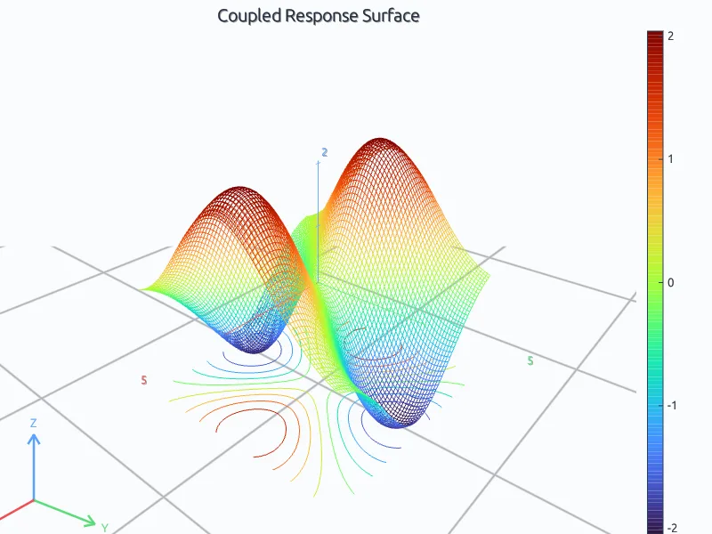

# Wireframe surface with a contour map below it using meshc

[](https://runmat.com/sandbox?example=plotting-meshc)

This example draws a response surface as a wireframe with `meshc`, which adds a contour map on the
floor of the plot. The surface is a saddle damped by a Gaussian, (x² − y²)·e^(−0.18(x² + y²)), with
two peaks and two pits of about ±2.

<picture>
  <source media="(prefers-color-scheme: dark)" srcset=".artifacts/thumbnail.webp">
  
</picture>

## The problem

A 3-D view shows a surface's shape but makes values hard to read; a contour map shows values but
hides the shape. `meshc` draws both, with the contour lines projected beneath the wireframe, so
each peak or pit can be matched to its rings on the floor. It suits response surfaces from design
studies, fitted models over two inputs and computed fields.

The function here multiplies a saddle by a decaying Gaussian:

```matlab
Z = (X.^2 - Y.^2).*exp(-0.18*(X.^2 + Y.^2));
```

Along the x-axis it is x²·e^(−0.18x²), which peaks where x² = 1/0.18, at x = ±2.36, with the value
5.56/e = 2.04 by the formula. Along the y-axis the pits reach −2.04.

## How the example works

1. **Sample the surface** on an 80 × 80 grid from −3 to 3:

   ```matlab
   [X, Y] = meshgrid(linspace(-3, 3, 80), linspace(-3, 3, 80));
   ```

2. **Draw the wireframe and its contours** in one call:

   ```matlab
   meshc(X, Y, Z);
   colormap('turbo');
   colorbar;
   view(40, 28);
   ```

## Results

The wireframe shows two red peaks along the x-axis and two blue pits along the y-axis, and the
color bar spans about −2 to 2. On the floor, the contour rings around each peak and pit sit
directly below them.

## What to try

1. Change the decay from 0.18 to 0.5. By the formula the peaks move in to x = ±1.41 and drop to
   0.74.
2. Swap `meshc` for [surfc](../surfc) to draw a shaded surface over the same contours.
3. Look straight down with `view(0, 90)` to see the contour map alone.

## Files

- `meshc.m`: the script: the damped saddle and the meshc plot.
- `runmat.toml`: the project file.

## Related

- [Plotting in RunMat](https://runmat.com/math/plotting)
- [Plotting guide](https://runmat.com/docs/runtime/plotting)
- [Wireframe mesh](../mesh) and [surface with contours](../surfc)
- Function reference: [`meshc`](https://runmat.com/docs/reference/builtins/meshc), [`mesh`](https://runmat.com/docs/reference/builtins/mesh), [`contour`](https://runmat.com/docs/reference/builtins/contour)
- [Download RunMat](https://runmat.com/download)
