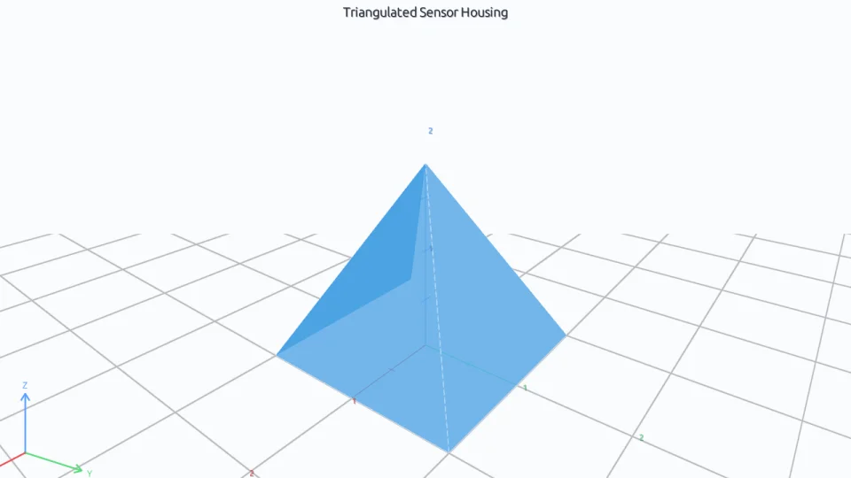

# Build a 3-D shape from faces and vertices with patch

[](https://runmat.com/sandbox?example=plotting-patch)

This example builds a square pyramid from a list of five vertices and four triangular faces with
`patch`, drawn translucent with light edges. The base is a 2 × 2 square at z = 0 and the apex
sits 1.8 above its center.

<picture>
  <source media="(prefers-color-scheme: dark)" srcset=".artifacts/thumbnail.webp">
  
</picture>

## The problem

A face-vertex list is how meshes are stored: STL files, finite element surface meshes, CAD
tessellations and 3-D scans all give a vertex table and a face table of row indices into it.
`patch` draws such a mesh directly. Each vertex is stored once, however many faces share it, and
per-face or per-vertex colors can show a field on the surface.

## How the example works

1. **List the vertices**, one row per point, and the faces, one row of vertex indices per
   triangle:

   ```matlab
   vertices = [-1 -1 0; 1 -1 0; 1 1 0; -1 1 0; 0 0 1.8];
   faces = [1 2 5; 2 3 5; 3 4 5; 4 1 5];
   ```

   Every face uses vertex 5, the apex, and two neighboring base corners.

2. **Draw the mesh** with a face color, an edge color and 72 % opacity:

   ```matlab
   patch('Faces', faces, 'Vertices', vertices, 'FaceColor', [0.25 0.65 0.95], ...
         'EdgeColor', [0.9 0.95 1.0], 'FaceAlpha', 0.72);
   view(38, 24);
   axis equal;
   ```

## Results

The figure shows the four sloping faces of the pyramid, with the light edges of the far faces
visible through the near ones. `axis equal` keeps the true proportions: each side face rises
1.8 over a half-width of 1, a slope of about 61°.

## What to try

1. Close the base with two more triangles by appending the rows `1 2 3; 1 3 4` to `faces`.
2. Raise the apex to z = 3. The side faces then slope at atan(3) = 71.6°.
3. Set `'FaceAlpha', 1` for an opaque solid.

## Files

- `patch.m`: the script: the vertex and face tables and the patch call.
- `runmat.toml`: the project file.

## Related

- [Plotting in RunMat](https://runmat.com/math/plotting)
- [Plotting guide](https://runmat.com/docs/runtime/plotting)
- [Filled 3-D polygons](../fill3) and [surface plot](../surf)
- Function reference: [`patch`](https://runmat.com/docs/reference/builtins/patch), [`view`](https://runmat.com/docs/reference/builtins/view)
- [Download RunMat](https://runmat.com/download)
