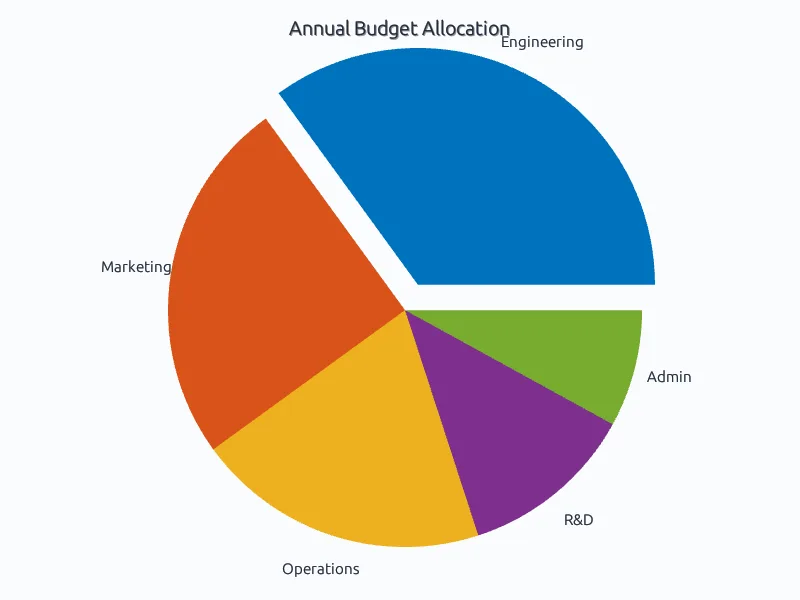

# Pie chart of budget shares with an exploded slice

[](https://runmat.com/sandbox?example=plotting-pie)

This example draws an annual budget split across five departments as a pie chart with `pie`,
labels each slice and pulls out the largest one, Engineering at 35 %. The other shares are
Marketing 25 %, Operations 20 %, R&D 12 % and Admin 8 %.

<picture>
  <source media="(prefers-color-scheme: dark)" srcset=".artifacts/thumbnail.webp">
  
</picture>

## The problem

A pie chart shows how one whole divides into a few parts. It works best with five or six slices or
fewer and when one share is the message, such as "Engineering takes over a third". Pulling a slice
out of the pie, called exploding it, draws attention to it. When the parts need to be compared
precisely with each other, or across years, a [bar chart](../bar) reads more accurately, since
lengths are easier to compare than angles.

## How the example works

1. **Set the values, labels and which slice to pull out**:

   ```matlab
   values = [35 25 20 12 8];
   labels = {'Engineering', 'Marketing', 'Operations', 'R&D', 'Admin'};
   explode = [1 0 0 0 0];
   ```

2. **Draw the pie**:

   ```matlab
   pie(values, explode, labels);
   ```

   `pie` divides each value by the total, here 100, so the slice angles are 35 %, 25 % and so on
   of a full turn.

## Results

The Engineering slice covers 126° and sits apart from the rest. Marketing and Operations together
take 45 %, and the two smallest departments, R&D and Admin, take 20 % between them.

## What to try

1. Explode two slices with `explode = [1 0 0 0 1]`.
2. Pass values that do not add to 100, such as costs in dollars; `pie` still converts them to
   shares of the total.
3. Show the same data as a bar chart with `bar(values)` and compare which differences are easier
   to read.

## Files

- `pie.m`: the script: the budget shares and the pie chart.
- `runmat.toml`: the project file.

## Related

- [Plotting in RunMat](https://runmat.com/math/plotting)
- [Plotting guide](https://runmat.com/docs/runtime/plotting)
- [Grouped bar chart](../bar) and [stacked area chart](../area)
- Function reference: [`pie`](https://runmat.com/docs/reference/builtins/pie), [`bar`](https://runmat.com/docs/reference/builtins/bar)
- [Download RunMat](https://runmat.com/download)
