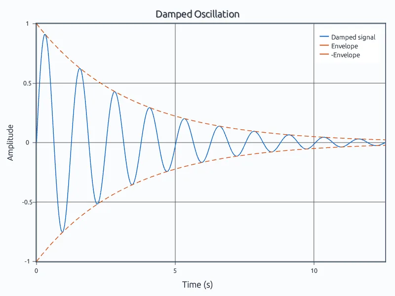

# Line plot of a damped oscillation and its envelope with plot and hold on

[](https://runmat.com/sandbox?example=basic-plot)

This example plots a damped sine wave, e^(−0.3t)·sin(5t), over 0 to 4π seconds with its upper and
lower envelopes as dashed lines, using `plot`, `hold on` and line properties set through handles.
The oscillation completes ten cycles while its amplitude decays from 1 to 0.023.

<picture>
  <source media="(prefers-color-scheme: dark)" srcset=".artifacts/thumbnail.webp">
  
</picture>

## The problem

`plot` is the basic 2-D line plot: a signal against time, a response against a parameter, a
measured curve against a model. Most engineering figures overlay several curves, which takes
`hold on` to keep earlier lines on the axes, line styles and colors to tell them apart, and a
legend to name them. This example shows that pattern with a decaying oscillation, the free
response of a lightly damped system, and the exponential envelope that bounds it.

## How the example works

1. **Compute the signal and its envelope** on 500 points:

   ```matlab
   t = linspace(0, 4*pi, 500);
   envelope = exp(-0.3*t);
   signal = envelope .* sin(5*t);
   ```

2. **Plot the signal**, keep the axes, and add both envelopes as dashed lines in one color:

   ```matlab
   h1 = plot(t, signal);
   set(h1, 'DisplayName', 'Damped signal', 'LineWidth', 1.5);
   hold on;
   h2 = plot(t, envelope, '--');
   set(h2, 'DisplayName', 'Envelope', 'LineWidth', 1.5, 'Color', [0.85 0.33 0.1]);
   ```

3. **Release the axes and add the legend** with `hold off` and `legend()`, which uses each line's
   `DisplayName`.

## Results

The signal reaches out almost to the dashed envelopes once per half cycle and decays inside them. The period is
2π/5 = 1.26 s, so 4π seconds hold ten cycles. By the end, e^(−0.3·4π) = 0.023, so the last cycles
are barely visible at this scale.

## What to try

1. Change the damping from 0.3 to 0.1 and look at how many cycles stay visible.
2. Put the amplitude on a log scale with `semilogy(t, abs(signal))`, where the envelope becomes a
   straight line.
3. Replace `set` with name-value pairs in the call, `plot(t, envelope, '--', 'LineWidth', 1.5)`.

## Files

- `plot.m`: the script: the damped signal, its envelopes and the legend.
- `runmat.toml`: the project file.

## Related

- [Plotting in RunMat](https://runmat.com/math/plotting)
- [Plotting guide](https://runmat.com/docs/runtime/plotting)
- [Semilog y-axis](../semilogy) and [animated line](../animated-line)
- Function reference: [`plot`](https://runmat.com/docs/reference/builtins/plot), [`hold`](https://runmat.com/docs/reference/builtins/hold), [`legend`](https://runmat.com/docs/reference/builtins/legend)
- [Download RunMat](https://runmat.com/download)
