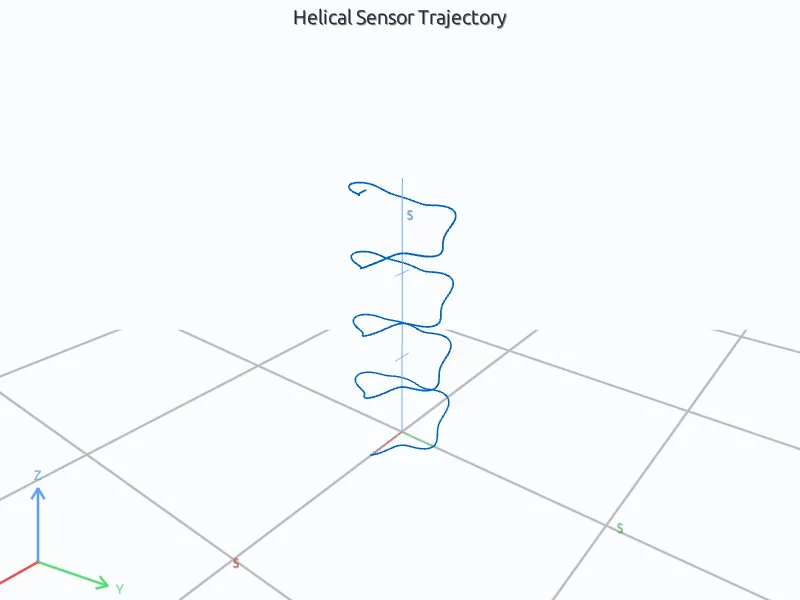

# 3-D line plot of a helical trajectory with plot3

[](https://runmat.com/sandbox?example=plotting-plot3)

This example draws a sensor's path through space as a 3-D line with `plot3`: four turns of a helix
that climbs 6 m, with a small wobble in radius and height. `axis equal` keeps the turns circular
at their true scale.

<picture>
  <source media="(prefers-color-scheme: dark)" srcset=".artifacts/thumbnail.webp">
  
</picture>

## The problem

`plot3` draws a curve through points given by x, y and z vectors. It is the plot for trajectories:
a probe on a robot arm, a tool path, a drone flight, a particle in a field, or the state of a
three-variable system over time. The path here is a helix, the shape of a probe on a rotating and
advancing spindle, with perturbations added:

```matlab
radius = 1 + 0.12*cos(5*t);
z = linspace(0, 6, 600) + 0.12*sin(3*t);
```

The radius varies between 0.88 and 1.12 m five times per turn, and the height wobbles by ±0.12 m
around a steady climb.

## How the example works

1. **Build the path** over four turns, t from 0 to 8π, in 600 points:

   ```matlab
   t = linspace(0, 8*pi, 600);
   x = radius.*cos(t);
   y = radius.*sin(t);
   ```

2. **Draw the line** with a thicker width, from a set view angle, with equal axis scaling:

   ```matlab
   h = plot3(x, y, z);
   set(h, 'LineWidth', 2);
   view(38, 26);
   axis equal;
   ```

## Results

The figure shows four stacked loops climbing from z = 0 to 6 m, each loop lumpy from the
five-per-turn radius ripple. Because the axes are equal, the 6 m height is three times the 2 m
loop diameter, matching the true shape.

## What to try

1. Color the path by time with `scatter3(x, y, z, 10, t, 'filled')`.
2. Remove the perturbations by setting both 0.12 terms to 0 for a clean helix.
3. Look from above with `view(0, 90)` to see the radius ripple as a five-lobed outline.

## Files

- `plot3.m`: the script: the perturbed helix and the 3-D line plot.
- `runmat.toml`: the project file.

## Related

- [Plotting in RunMat](https://runmat.com/math/plotting)
- [Plotting guide](https://runmat.com/docs/runtime/plotting)
- [3-D scatter plot](../scatter3) and [line plot](../plot)
- Function reference: [`plot3`](https://runmat.com/docs/reference/builtins/plot3), [`view`](https://runmat.com/docs/reference/builtins/view), [`axis`](https://runmat.com/docs/reference/builtins/axis)
- [Download RunMat](https://runmat.com/download)
