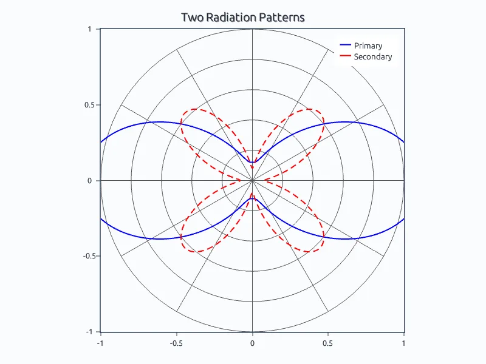

# Plot antenna radiation patterns on polar axes with polarplot

[](https://runmat.com/sandbox?example=plotting-polarplot)

This example draws two radiation patterns on polar axes with `polarplot`: a two-lobed primary
pattern pointing along 0° and 180°, and a four-lobed secondary pattern pointing along the
diagonals. The primary pattern reaches 1.12 on its axis; the secondary peaks at 0.63.

<picture>
  <source media="(prefers-color-scheme: dark)" srcset=".artifacts/thumbnail.webp">
  
</picture>

## The problem

Quantities that depend on direction read best on polar axes: antenna gain against angle, a
microphone's pickup pattern, a sound source's directivity, wind speed by heading, or a stress
component against orientation. On polar axes the radius is the value and the angle is the
direction, so lobes and nulls appear where they point.

The two patterns here are models:

```matlab
primary = abs(cos(theta)).^3 + 0.12;
secondary = 0.55*abs(sin(2*theta)).^2 + 0.08;
```

The primary has maxima of 1 + 0.12 at 0° and 180° and a floor of 0.12 at 90° and 270°. The
secondary has four lobes of 0.55 + 0.08 = 0.63 at 45°, 135°, 225° and 315°.

## How the example works

1. **Sample the angle** around the full circle:

   ```matlab
   theta = linspace(0, 2*pi, 500);
   ```

2. **Draw both patterns** on the same polar axes, with different line styles, and a legend:

   ```matlab
   polarplot(theta, primary, 'b-');
   hold on;
   polarplot(theta, secondary, 'r--', 'LineWidth', 2);
   legend('Primary', 'Secondary');
   ```

## Results

The figure shows the solid blue primary pattern as two broad lobes along the horizontal axis and
the dashed red secondary pattern as a four-leaf shape along the diagonals. The secondary's lobes
fall halfway between the primary's, 45° off its axis, and both patterns have their minimum at 90°
and 270°.

## What to try

1. Normalize both patterns to their own peaks, `primary/max(primary)`, so each lobe reaches 1.
2. Sharpen the primary beam by raising the exponent from 3 to 9.

## Files

- `polarplot.m`: the script: the two patterns and the polar plot.
- `runmat.toml`: the project file.

## Related

- [Plotting in RunMat](https://runmat.com/math/plotting)
- [Plotting guide](https://runmat.com/docs/runtime/plotting)
- [Line plot](../plot) and [3-D line plot](../plot3)
- Function reference: [`polarplot`](https://runmat.com/docs/reference/builtins/polarplot), [`hold`](https://runmat.com/docs/reference/builtins/hold), [`legend`](https://runmat.com/docs/reference/builtins/legend)
- [Download RunMat](https://runmat.com/download)
