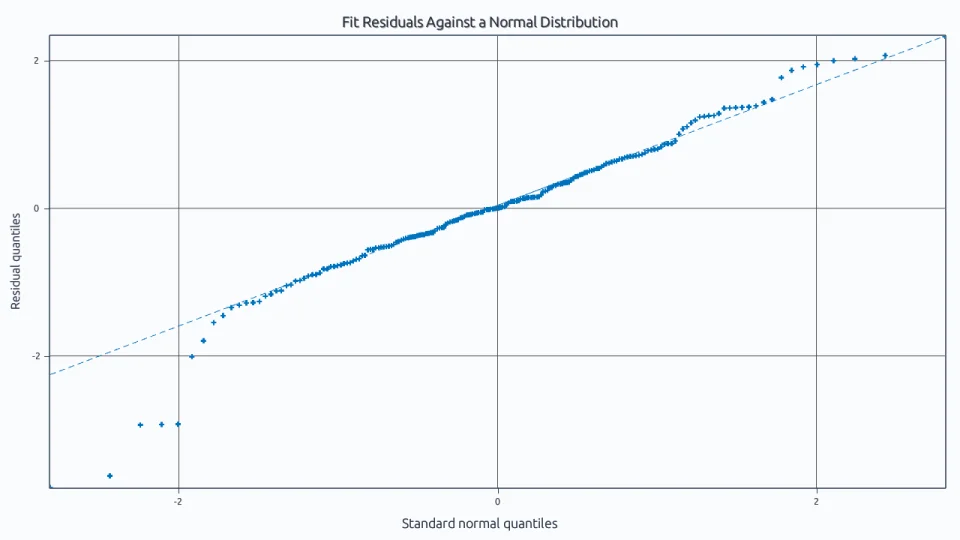

# Check fit residuals for normality with a Q-Q plot

[](https://runmat.com/sandbox?example=plotting-qqplot)

This example checks whether 200 regression residuals follow a normal distribution with `qqplot`,
which plots the sorted residuals against the matching quantiles of a standard normal. The middle
of the sample follows the reference line, and the points peel away from it in both tails, the sign
of tails heavier than normal.

<picture>
  <source media="(prefers-color-scheme: dark)" srcset=".artifacts/thumbnail.webp">
  
</picture>

## The problem

Confidence intervals and tests from a least-squares fit assume normally distributed errors. A
histogram of residuals hides the tails, where the assumption usually fails. A quantile-quantile
plot shows them: the i-th smallest residual is plotted against the normal quantile for that rank.
If the residuals are normal, the points fall on a straight line, whose slope is the standard
deviation and intercept the mean. An S-shape, with low points below the line and high points above
it, means heavy tails; a curve bending one way means skew.

The residuals here are mostly normal with a small cubed-normal term added, which stretches the
extremes:

```matlab
residuals = 0.8*randn(200, 1) + 0.15*randn(200, 1).^3;
```

## How the example works

1. **Simulate the residuals** with a fixed seed:

   ```matlab
   rng(5);
   residuals = 0.8*randn(200, 1) + 0.15*randn(200, 1).^3;
   ```

2. **Draw the Q-Q plot**; `qqplot` adds a dashed reference line through the first and third
   quartiles:

   ```matlab
   qqplot(residuals);
   ```

## Results

Through the middle of the sample the points lie on the reference line. In the tails the lowest few residuals fall well below it and the highest ones sit above it, the S-shape of
heavy tails. In a real fit, those points are the ones to inspect for outliers or a missing term
in the model.

## What to try

1. Remove the cubed term and check that the tails come back to the line.
2. Raise the sample to 2000 and look at how far the tails stray with more data.
3. Skew the residuals with `exp(0.5*randn(200, 1))` and look for a curve instead of an S.

## Files

- `qqplot.m`: the script: the simulated residuals and the Q-Q plot.
- `runmat.toml`: the project file.

## Related

- [Plotting in RunMat](https://runmat.com/math/plotting)
- [Statistics in RunMat](https://runmat.com/math/statistics)
- [Empirical CDFs](../cdfplot) and [histogram](../histogram)
- Function reference: [`qqplot`](https://runmat.com/docs/reference/builtins/qqplot), [`randn`](https://runmat.com/docs/reference/builtins/randn)
- [Download RunMat](https://runmat.com/download)
