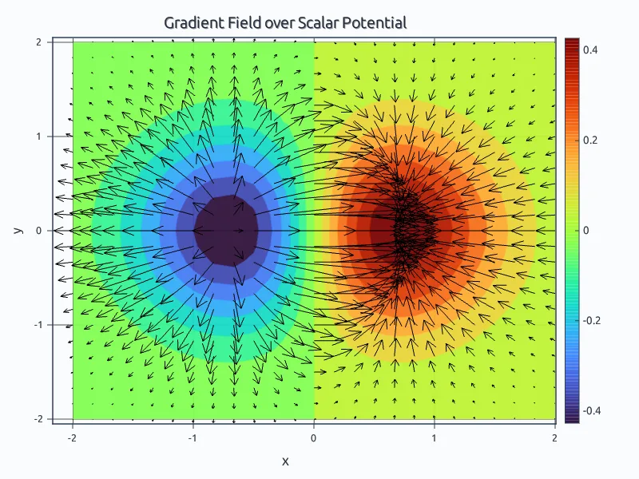

# Plot a gradient field as arrows over a contour map with quiver

[](https://runmat.com/sandbox?example=plotting-quiver)

This example computes the gradient of the potential z = x·e^(−x² − y²) on a 25 × 25 grid with
`gradient` and draws it as arrows with `quiver`, over filled contours of the potential itself. The
field has a maximum of 0.43 at (0.71, 0) and a matching minimum of −0.43 at (−0.71, 0), and the
arrows point uphill toward the maximum and away from the minimum.

<picture>
  <source media="(prefers-color-scheme: dark)" srcset=".artifacts/thumbnail.webp">
  
</picture>

## The problem

`quiver` draws a vector field as arrows: a velocity field from a flow simulation, a force or
electric field, a heat flux, or the gradient of a cost function. Laying the arrows over contours of
a scalar shows how the two relate. A gradient is always perpendicular to the contour lines and
longest where they are closest together.

## How the example works

1. **Sample the potential** on a 25 × 25 grid from −2 to 2:

   ```matlab
   [X, Y] = meshgrid(linspace(-2, 2, 25), linspace(-2, 2, 25));
   Z = X .* exp(-X.^2 - Y.^2);
   ```

2. **Take the numerical gradient**, passing the grid spacing so the result is in units per unit
   length:

   ```matlab
   [DX, DY] = gradient(Z, X(1,2)-X(1,1), Y(2,1)-Y(1,1));
   ```

3. **Draw filled contours, then the arrows on top**:

   ```matlab
   contourf(X, Y, Z, 15);
   hold on;
   quiver(X, Y, DX, DY, 'k', 'LineWidth', 1);
   ```

## Results

The contours show a warm lobe on the right and a cool lobe on the left, with a color bar spanning
about ±0.4. The black arrows cross the contour bands at right angles, converge on the red maximum
and spread out from the blue minimum. The longest arrows sit between the two lobes near the origin,
where the potential changes fastest; there the gradient is 1 in the x direction, by the formula.

## What to try

1. Use a coarser 15 × 15 grid for the arrows so each one is easier to see.
2. Plot `-DX, -DY` to show the steepest-descent direction an optimizer would follow.

## Files

- `quiver.m`: the script: the potential, its numerical gradient and the arrow plot.
- `runmat.toml`: the project file.

## Related

- [Plotting in RunMat](https://runmat.com/math/plotting)
- [Plotting guide](https://runmat.com/docs/runtime/plotting)
- [Filled contours](../contourf) and [contour lines](../contour)
- Function reference: [`quiver`](https://runmat.com/docs/reference/builtins/quiver), [`gradient`](https://runmat.com/docs/reference/builtins/gradient), [`contourf`](https://runmat.com/docs/reference/builtins/contourf)
- [Download RunMat](https://runmat.com/download)
