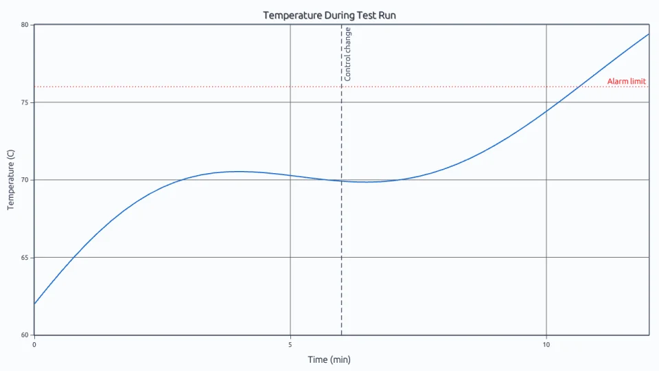

# Mark an event and a limit on a plot with xline and yline

[](https://runmat.com/sandbox?example=plotting-reference-lines)

This example plots a temperature record from a 12-minute test run and adds two reference lines: a
dashed vertical `xline` at 6 min labeled "Control change" and a dotted red horizontal `yline` at
76 °C labeled "Alarm limit". The temperature crosses the alarm limit at about 10.6 min, by the
formula behind the data.

<picture>
  <source media="(prefers-color-scheme: dark)" srcset=".artifacts/thumbnail.webp">
  
</picture>

## The problem

Test data is read against events and limits: when a setpoint changed, when a valve opened, the
alarm threshold, the specification band. `xline` and `yline` draw a line across the whole axes at
one x or y value, with an optional label, and stay full-width when the axes are zoomed or their
limits change. That makes them the simple way to mark a time or a threshold without computing
line endpoints.

The temperature here rises steadily at 1.4 °C/min with a decaying oscillation on top:

```matlab
temperature = 62 + 1.4*time + 5*sin(0.55*time).*exp(-0.08*time);
```

## How the example works

1. **Plot the temperature record**, sampled every 15 s:

   ```matlab
   time = 0:0.25:12;
   plot(time, temperature, 'LineWidth', 2);
   ```

2. **Add the event and the limit**, each with a line style and a label:

   ```matlab
   xline(6, '--', 'Control change', 'LineWidth', 1.5);
   yline(76, ':r', 'Alarm limit', 'LineWidth', 1.5);
   ylim([60 80]);
   ```

## Results

The temperature climbs from 62 °C to a local peak of 70.5 °C near 4 min, dips to 69.9 °C at 6.5 min,
just after the control change, then rises again and passes the 76 °C alarm limit at about
10.6 min, ending at 79.4 °C. These values come from the formula above, evaluated finely.

## What to try

1. Lower the alarm limit to 72 °C. By the formula the temperature crosses it at about 8.9 min.
2. Add a lower limit, `yline(65, ':b', 'Low limit')`.
3. Mark the crossing time with `xline(10.64, '-.', 'Alarm')`.

## Files

- `reference-lines.m`: the script: the temperature record and the two reference lines.
- `runmat.toml`: the project file.

## Related

- [Plotting in RunMat](https://runmat.com/math/plotting)
- [Plotting guide](https://runmat.com/docs/runtime/plotting)
- [Line plot](../plot) and [error bars](../errorbar)
- Function reference: [`xline`](https://runmat.com/docs/reference/builtins/xline), [`yline`](https://runmat.com/docs/reference/builtins/yline), [`ylim`](https://runmat.com/docs/reference/builtins/ylim)
- [Download RunMat](https://runmat.com/download)
