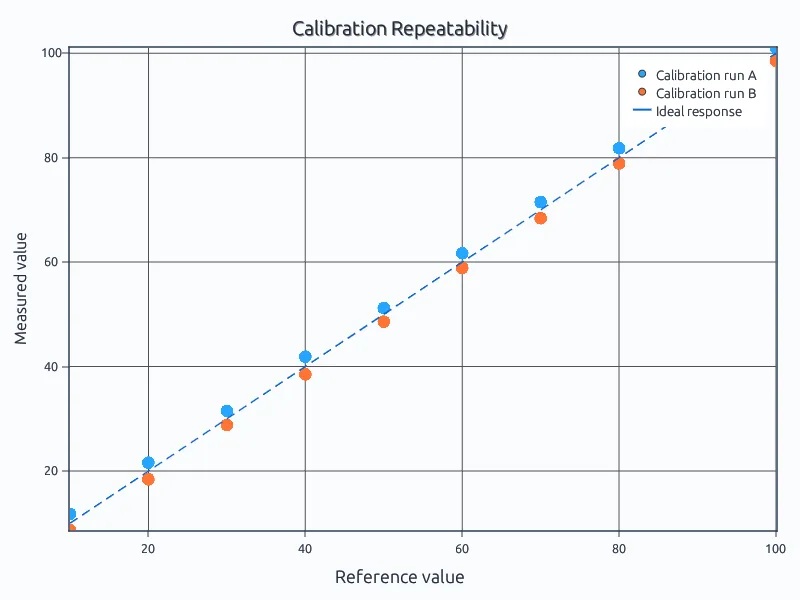

# Scatter plot of two calibration runs against the ideal line

[](https://runmat.com/sandbox?example=plotting-scatter)

This example compares two calibration runs of a sensor against reference values from 10 to 100
with `scatter`, adding a dashed line for the ideal response measured = reference. Run A reads high
by 1.53 on average and run B reads low by 1.36, so the two runs differ by 2.89 on average at the
same reference value.

<picture>
  <source media="(prefers-color-scheme: dark)" srcset=".artifacts/thumbnail.webp">
  
</picture>

## The problem

A scatter plot shows paired values as points: measured against reference, predicted against
actual, one variable against another. For a calibration the key addition is the identity line.
Points on the line are correct; a constant offset shifts all points above or below it; a gain
error tilts them away from it. Plotting two runs together shows repeatability: whether the
instrument gives the same reading twice.

## How the example works

1. **Set the reference values and the two runs**:

   ```matlab
   reference = 10:10:100;
   run_a = [11.8 21.6 31.5 41.9 51.2 61.7 71.5 81.8 91.3 101.0];
   run_b = [8.7 18.4 28.8 38.5 48.6 58.9 68.4 78.9 88.7 98.5];
   ```

2. **Draw each run as filled markers** of size 90 in its own color, then the ideal line:

   ```matlab
   scatter(reference, run_a, 90, [0.15 0.65 1.0], 'filled');
   hold on;
   scatter(reference, run_b, 90, [1.0 0.45 0.2], 'filled');
   plot([10 100], [10 100], '--', 'LineWidth', 1.5);
   ```

## Results

Every run A point sits above the dashed line, by 1.0 to 1.9, and every run B point below it, by
1.1 to 1.6. Neither error grows with the reference value, so both look like offsets rather than
gain errors. The 2.89 average gap between runs is the repeatability problem to chase: the same
sensor read the same reference differently on two occasions.

## What to try

1. Plot the errors instead, `scatter(reference, run_a - reference)`, to magnify the offsets.
2. Fit a line to each run with `polyfit(reference, run_a, 1)` and compare the slopes with 1.
3. Color each point by its error with `scatter(reference, run_a, 90, run_a - reference, 'filled')`.

## Files

- `scatter.m`: the script: the two calibration runs, the scatter plot and the ideal line.
- `runmat.toml`: the project file.

## Related

- [Plotting in RunMat](https://runmat.com/math/plotting)
- [Plotting guide](https://runmat.com/docs/runtime/plotting)
- [3-D scatter plot](../scatter3) and [error bars](../errorbar)
- Function reference: [`scatter`](https://runmat.com/docs/reference/builtins/scatter), [`polyfit`](https://runmat.com/docs/reference/builtins/polyfit)
- [Download RunMat](https://runmat.com/download)
