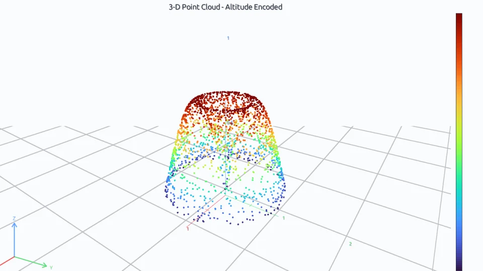

# 3-D scatter plot of a point cloud colored by height with scatter3

[](https://runmat.com/sandbox?example=plotting-scatter3)

This example scatters 2000 random points over a unit disk, lifts each to the height
z = sin(3r)/(1 + r), and draws them with `scatter3`, colored by z. The cloud forms a raised ring:
low at the center, highest at a radius of about 0.45 and lower again at the rim.

<picture>
  <source media="(prefers-color-scheme: dark)" srcset=".artifacts/thumbnail.webp">
  
</picture>

## The problem

A 3-D scatter plot shows unstructured points: survey or lidar returns, probe measurements at
scattered locations, samples from a design study over two inputs and one output, or particles in
a simulation. Coloring by a value adds a fourth variable, or makes height easier to read than
perspective alone allows.

The points here are spread uniformly over the disk. Taking r = √u for a uniform u keeps the point
density even, since the area within radius r grows as r²:

```matlab
theta = 4*pi*rand(1, n);
r = sqrt(rand(1, n));
z = sin(3*r) ./ (1 + r);
```

## How the example works

1. **Generate the points** with a fixed seed and convert to x and y.

2. **Draw them as filled markers** of size 12, colored by their own z values:

   ```matlab
   scatter3(x, y, z, 12, z, 'filled');
   colormap('turbo');
   colorbar;
   view(35, 25);
   ```

## Results

Seen from the side, the cloud is a dome-like shell: red points along the top of the ridge, yellow
and green down its flanks, and blue points at the rim. By the formula the ridge peaks at 0.67 at
r = 0.45, the rim sits at 0.07, and the center dips to 0; the center points are hidden behind the
ridge from this view.

## What to try

1. Look from above with `view(0, 90)` to see the color rings and the low center.
2. Drop the square root, `r = rand(1, n)`, and look at how the points crowd toward the center.
3. Size the markers by height as well, `scatter3(x, y, z, 40*z + 4, z, 'filled')`.

## Files

- `scatter3.m`: the script: the random point cloud and the 3-D scatter plot.
- `runmat.toml`: the project file.

## Related

- [Plotting in RunMat](https://runmat.com/math/plotting)
- [Plotting guide](https://runmat.com/docs/runtime/plotting)
- [2-D scatter plot](../scatter) and [3-D line plot](../plot3)
- Function reference: [`scatter3`](https://runmat.com/docs/reference/builtins/scatter3), [`rand`](https://runmat.com/docs/reference/builtins/rand), [`colormap`](https://runmat.com/docs/reference/builtins/colormap)
- [Download RunMat](https://runmat.com/download)
