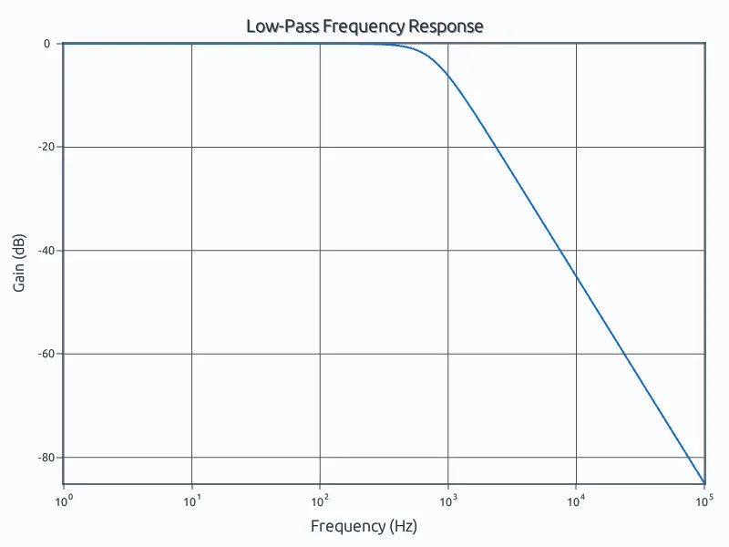

# Plot a low-pass frequency response on a log frequency axis with semilogx

[](https://runmat.com/sandbox?example=plotting-semilogx)

This example plots the gain of a second-order low-pass filter with a 750 Hz cutoff from 1 Hz to
100 kHz with `semilogx`, which puts frequency on a logarithmic axis and gain in decibels on a
linear one. The gain is flat at 0 dB, falls 3 dB at the cutoff and then rolls off at 40 dB per
decade, reaching −85.0 dB at 100 kHz.

<picture>
  <source media="(prefers-color-scheme: dark)" srcset=".artifacts/thumbnail.webp">
  
</picture>

## The problem

Frequency responses span several decades: an audio filter from 20 Hz to 20 kHz, a structural
response from 1 Hz to 1 kHz, a control loop from 0.01 to 100 rad/s. On a linear axis the low
decades collapse against the left edge. A log frequency axis gives each decade the same width,
and with gain in decibels the roll-off of a filter of order n becomes a straight line of slope
−20n dB per decade, which is how filters are specified and compared.

The gain here is the magnitude of a second-order Butterworth low-pass filter:

$$|H(f)| = \frac{1}{\sqrt{1 + (f/f_c)^4}}$$

## How the example works

1. **Sample 400 log-spaced frequencies** and compute the gain in dB:

   ```matlab
   frequency = logspace(0, 5, 400);
   cutoff = 750;
   gain_db = 20*log10(1 ./ sqrt(1 + (frequency/cutoff).^4));
   ```

2. **Plot on a log frequency axis**:

   ```matlab
   h = semilogx(frequency, gain_db);
   set(h, 'LineWidth', 2);
   ```

## Results

The curve is flat up to a few hundred hertz, bends at the 750 Hz cutoff, and is a straight line
beyond it. By the formula the gain is −40.0 dB at 7.5 kHz, one decade above the cutoff, and
−85.0 dB at 100 kHz.

## What to try

1. Change the exponent from 4 to 8 for a fourth-order filter and compare the slope, 80 dB per
   decade.
2. Add `xline(cutoff, '--')` and `yline(-3, ':')` to mark the cutoff.
3. Plot the same data with `plot` on linear axes to see why the log axis is used.

## Files

- `semilogx.m`: the script: the filter gain and the semilog plot.
- `runmat.toml`: the project file.

## Related

- [Plotting in RunMat](https://runmat.com/math/plotting)
- [Plotting guide](https://runmat.com/docs/runtime/plotting)
- [Semilog y-axis](../semilogy) and [log-log axes](../loglog)
- Function reference: [`semilogx`](https://runmat.com/docs/reference/builtins/semilogx), [`logspace`](https://runmat.com/docs/reference/builtins/logspace)
- [Download RunMat](https://runmat.com/download)
