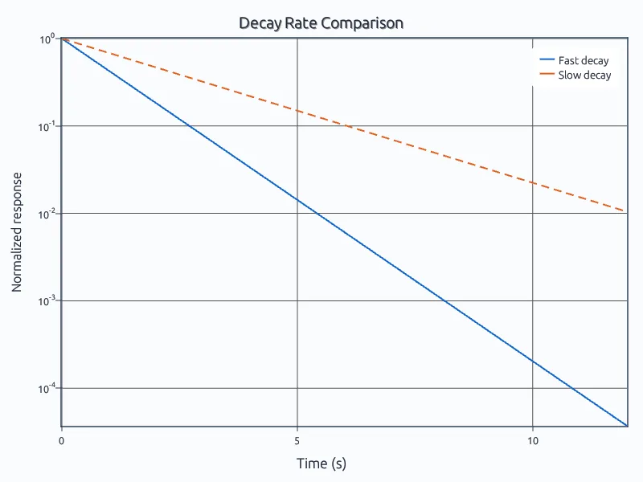

# Compare exponential decay rates on a log y-axis with semilogy

[](https://runmat.com/sandbox?example=plotting-semilogy)

This example plots two exponential decays, e^(−0.85t) and e^(−0.38t), over 12 s with `semilogy`,
which puts the response on a logarithmic axis. On it each decay is a straight line whose slope is
set by its rate, so the two rates compare at a glance. By 12 s the fast decay has fallen to
3.7 × 10⁻⁵ and the slow one to 0.0105.

<picture>
  <source media="(prefers-color-scheme: dark)" srcset=".artifacts/thumbnail.webp">
  
</picture>

## The problem

Exponential decays turn up in cooling, discharge of a capacitor, radioactive decay, settling of a
damped system and convergence of an iterative solver. On linear axes every decay looks like the
same curve that vanishes into the axis. On a log y-axis, y = e^(−at) becomes log₁₀ y = −a·t/ln 10,
a straight line. The slope gives the rate, a departure from a straight line shows a second
process, and values spanning many decades stay readable.

## How the example works

1. **Compute both decays** on 300 points:

   ```matlab
   time = linspace(0, 12, 300);
   fast = exp(-0.85*time);
   slow = exp(-0.38*time);
   ```

2. **Plot them on a log y-axis**, solid and dashed, with display names for the legend:

   ```matlab
   h1 = semilogy(time, fast);
   set(h1, 'LineWidth', 2, 'DisplayName', 'Fast decay');
   hold on;
   h2 = semilogy(time, slow, '--');
   ```

## Results

Both curves are straight lines from 1 at t = 0. The fast decay drops one decade every 2.71 s
(ln 10/0.85) and the slow one every 6.06 s (ln 10/0.38). Their time constants are 1.18 s and
2.63 s. The y-axis spans more than four decades, from 1 down to 3.7 × 10⁻⁵.

## What to try

1. Add the sum `0.5*fast + 0.5*slow` and look at the bend where the slow term takes over.
2. Fit a decay rate back from data with `polyfit(time, log(slow), 1)`; the slope is −0.38.
3. Plot the same curves with `plot` to compare.

## Files

- `semilogy.m`: the script: the two decays and the semilog plot.
- `runmat.toml`: the project file.

## Related

- [Plotting in RunMat](https://runmat.com/math/plotting)
- [Plotting guide](https://runmat.com/docs/runtime/plotting)
- [Semilog x-axis](../semilogx) and [log-log axes](../loglog)
- Function reference: [`semilogy`](https://runmat.com/docs/reference/builtins/semilogy), [`legend`](https://runmat.com/docs/reference/builtins/legend)
- [Download RunMat](https://runmat.com/download)
