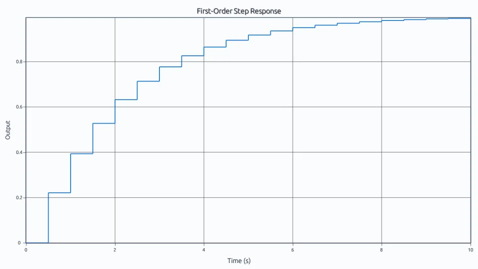

# Plot sampled data as a staircase with stairs

[](https://runmat.com/sandbox?example=plotting-stairs)

This example samples a first-order step response, y = 1 − e^(−0.5t), every 0.5 s from 0 to 10 s
and draws it with `stairs`, which holds each sample until the next one. The output climbs in
21 steps toward 1 and ends at 0.993.

<picture>
  <source media="(prefers-color-scheme: dark)" srcset=".artifacts/thumbnail.webp">
  
</picture>

## The problem

Digital systems hold values between updates: a controller's output through a zero-order hold, a
data logger's readings, a setpoint schedule, or a count per interval. Drawing such data with
`plot` joins samples with sloped lines that imply values the system never had. `stairs` draws a
horizontal segment from each sample to the next and a vertical jump at each update, which is what
the hardware does.

## How the example works

1. **Sample the response** every 0.5 s:

   ```matlab
   t = 0:0.5:10;
   y = 1 - exp(-0.5*t);
   ```

2. **Draw it as a staircase**:

   ```matlab
   h = stairs(t, y);
   set(h, 'LineWidth', 2);
   ```

## Results

The output holds at 0 for the first half second, jumps to 0.221 at t = 0.5 s, and the steps shrink
as the response approaches 1. The time constant is 2 s, so the output passes 0.632 at t = 2 s and
0.993 by t = 10 s.

## What to try

1. Mark the samples themselves with `hold on; plot(t, y, 'o')`.
2. Sample every 2 s instead and look at how coarse the staircase gets.
3. Plot a setpoint schedule, such as `stairs([0 2 5 8], [20 50 35 35])`.

## Files

- `stairs.m`: the script: the sampled step response and the staircase plot.
- `runmat.toml`: the project file.

## Related

- [Plotting in RunMat](https://runmat.com/math/plotting)
- [Plotting guide](https://runmat.com/docs/runtime/plotting)
- [Stem plot](../stem) and [line plot](../plot)
- Function reference: [`stairs`](https://runmat.com/docs/reference/builtins/stairs), [`plot`](https://runmat.com/docs/reference/builtins/plot)
- [Download RunMat](https://runmat.com/download)
