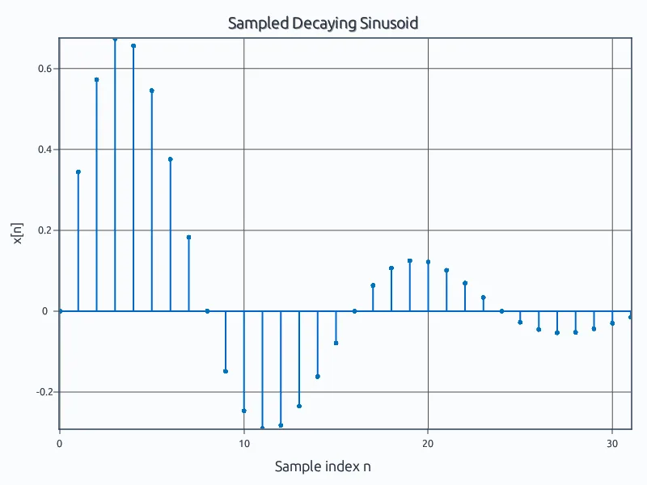

# Plot a discrete-time signal with stem

[](https://runmat.com/sandbox?example=plotting-stem)

This example draws 32 samples of a decaying sinusoid, x[n] = sin(2πn/16)·0.9ⁿ, with `stem`, which
marks each sample with a vertical line from zero and a marker at its value. The sinusoid has a
period of 16 samples, so the plot shows two cycles, and the largest sample is 0.674 at n = 3.

<picture>
  <source media="(prefers-color-scheme: dark)" srcset=".artifacts/thumbnail.webp">
  
</picture>

## The problem

A discrete-time signal exists only at its sample instants. `stem` shows exactly that: one stem
per sample, with nothing drawn in between. It is the standard plot for digital filter impulse
responses, sampled sensor data, the coefficients of a filter, and the bins of a discrete
spectrum. Drawing the same data with `plot` would join the samples with lines and suggest values
between them.

## How the example works

1. **Compute the samples** for n = 0 to 31:

   ```matlab
   n = 0:31;
   x = sin(2*pi*n/16) .* (0.9 .^ n);
   ```

2. **Draw them as stems**:

   ```matlab
   stem(n, x);
   ```

## Results

The first cycle reaches 0.674 at n = 3 and −0.290 at n = 11. The decay factor of 0.9 per sample
shrinks the amplitude to 0.9¹⁶ = 0.185 of its value over one 16-sample period. The samples at n = 0, 8, 16 and 24 are exactly zero, where the sine crosses zero.

## What to try

1. Change the period to 8 samples, `sin(2*pi*n/8)`, and look at the coarser sampling of each
   cycle.
2. Overlay the continuous envelope with `hold on; plot(n, 0.9.^n, '--')`.
3. Use `stem(n, x, 'filled')` for filled markers.

## Files

- `stem.m`: the script: the sampled signal and the stem plot.
- `runmat.toml`: the project file.

## Related

- [Plotting in RunMat](https://runmat.com/math/plotting)
- [Plotting guide](https://runmat.com/docs/runtime/plotting)
- [Staircase plot](../stairs) and [line plot](../plot)
- Function reference: [`stem`](https://runmat.com/docs/reference/builtins/stem), [`stairs`](https://runmat.com/docs/reference/builtins/stairs)
- [Download RunMat](https://runmat.com/download)
