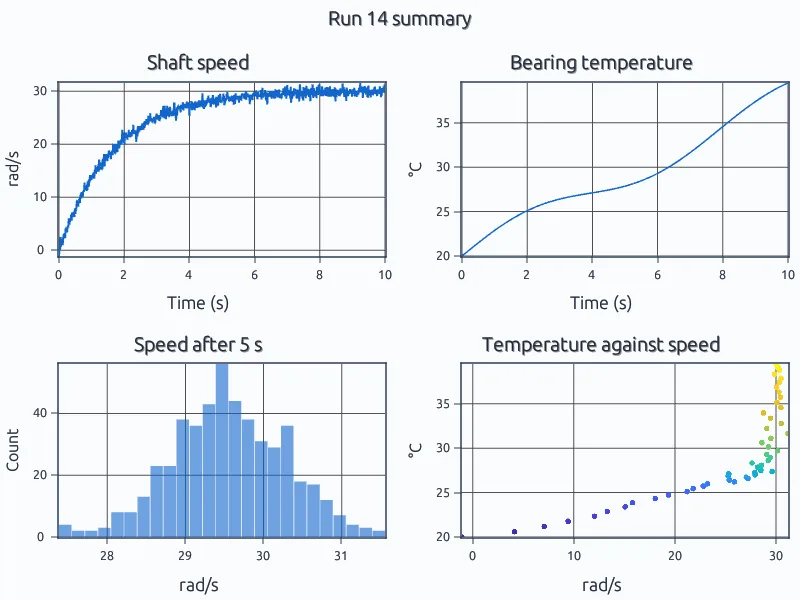

# Summarize a test run in one figure with subplot and sgtitle

[](https://runmat.com/sandbox?example=plotting-subplot-summary)

This example lays out four views of one test run in a 2 × 2 grid with `subplot` and gives the
figure an overall title with `sgtitle`: shaft speed against time, bearing temperature against
time, a histogram of speed once it has settled, and temperature against speed colored by time.

<picture>
  <source media="(prefers-color-scheme: dark)" srcset=".artifacts/thumbnail.webp">
  
</picture>

## The problem

A summary figure puts time histories, distributions and
cross-plots side by side, so spin-up, steady-state noise and thermal behavior can be checked in
one view. `subplot(m, n, k)` divides the figure
into an m × n grid and makes panel k current; each panel then takes any plot command.

The run here is simulated: speed rises to 30 rad/s with a 1/0.6 = 1.67 s time constant plus
0.6 rad/s of noise, and the bearing temperature climbs 1.8 °C/s with a slow oscillation.

## How the example works

1. **Simulate the run** at 100 samples per second for 10 s:

   ```matlab
   rng(2);
   t = 0:0.01:10;
   speed = 30*(1 - exp(-0.6*t)) + 0.6*randn(size(t));
   temp = 20 + 1.8*t + 1.5*sin(0.8*t);
   ```

2. **Fill each panel** after selecting it, for example the histogram and the colored scatter:

   ```matlab
   subplot(2, 2, 3);
   histogram(speed(t > 5), 25);
   subplot(2, 2, 4);
   scatter(speed(1:20:end), temp(1:20:end), 18, t(1:20:end), 'filled');
   ```

3. **Title the whole figure**:

   ```matlab
   sgtitle('Run 14 summary');
   ```

## Results

The speed panel shows the spin-up, leveling off near 30 rad/s. The histogram of the last 5 s is
centered just below 30 with the spread of the 0.6 rad/s noise; by the formula the noise-free speed
rises from 28.5 to 29.9 rad/s over that window. The temperature rises from 20 °C to 39.5 °C. In
the scatter, early points spread along the speed axis at low temperature, and late points stack
up at constant speed while the temperature keeps rising.

## What to try

1. Change the grid to `subplot(4, 1, k)` to stack the four panels for a tall report page.
2. Add `colorbar` after the scatter so the time coloring can be read.

## Files

- `subplot-summary.m`: the script: the simulated run and the four-panel figure.
- `runmat.toml`: the project file.

## Related

- [Plotting in RunMat](https://runmat.com/math/plotting)
- [Plotting guide](https://runmat.com/docs/runtime/plotting)
- [Surface and contours side by side](../surface-and-contours) and [histogram](../histogram)
- Function reference: [`subplot`](https://runmat.com/docs/reference/builtins/subplot), [`sgtitle`](https://runmat.com/docs/reference/builtins/sgtitle), [`histogram`](https://runmat.com/docs/reference/builtins/histogram)
- [Download RunMat](https://runmat.com/download)
