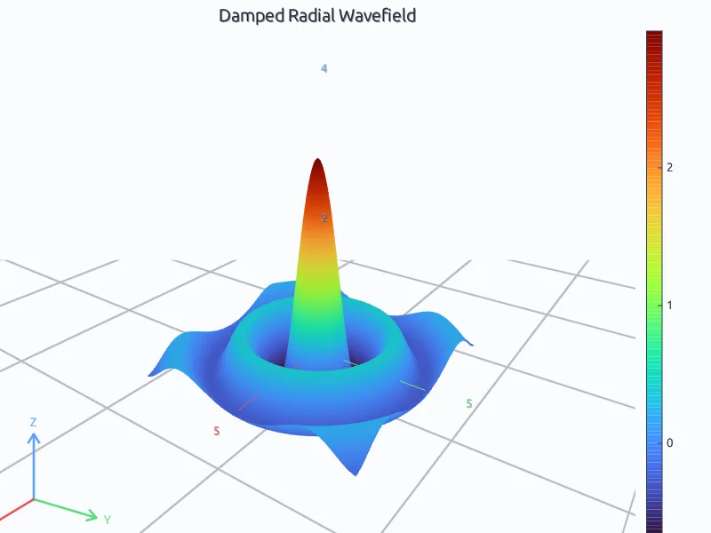

# Shaded 3-D surface plot with surf and interpolated shading

[](https://runmat.com/sandbox?example=plotting-surf)

This example draws the damped radial wave z = sin(3r)/r on a 200 × 200 grid with `surf`, using
`shading interp` to blend colors smoothly across each grid cell. A tall central peak sits inside
ripples that shrink with distance from the center.

<picture>
  <source media="(prefers-color-scheme: dark)" srcset=".artifacts/thumbnail.webp">
  
</picture>

## The problem

`surf` is the general-purpose surface plot: a height field over a grid of x and y, drawn as
colored faces. It suits computed fields such as a displacement, a pressure or a potential, response
surfaces from parameter sweeps, and measured maps. Interpolated shading hides the grid lines and
blends colors across faces, which gives a fine grid like this one a smooth look. The function here
is sin(kr)/r, the radial profile of a standing spherical wave around a point source.

## How the example works

1. **Build the grid** and the radius; adding 0.01 avoids dividing by zero at the origin:

   ```matlab
   [X, Y] = meshgrid(linspace(-4, 4, 200), linspace(-4, 4, 200));
   R = sqrt(X.^2 + Y.^2) + 0.01;
   Z = sin(3*R) ./ R;
   ```

2. **Draw the surface** with interpolated shading, the turbo colormap, a color bar and a set
   view angle:

   ```matlab
   surf(X, Y, Z);
   shading interp;
   colormap('turbo');
   colorbar;
   view(35, 25);
   ```

## Results

The central peak is close to 3, the limit of sin(3r)/r as r goes to 0, and the color bar tops out
there. Around it, the first trough lies between r ≈ 1.04 and 2.08, and each later ring is lower
because of the 1/r decay. The [damped radial wave](../damped-radial-wave) example draws the same
function on a coarser 120 × 120 grid.

## What to try

1. Compare `shading faceted` and `shading flat` with `shading interp`.
2. Change the wave number from 3 to 5 for more, closer rings.
3. Look from above with `view(0, 90)` to see the rings as a flat color map.

## Files

- `surf.m`: the script: the radial wave and the shaded surface.
- `runmat.toml`: the project file.

## Related

- [Plotting in RunMat](https://runmat.com/math/plotting)
- [Plotting guide](https://runmat.com/docs/runtime/plotting)
- [Surface with contours](../surfc) and [wireframe mesh](../mesh)
- Function reference: [`surf`](https://runmat.com/docs/reference/builtins/surf), [`shading`](https://runmat.com/docs/reference/builtins/shading), [`colormap`](https://runmat.com/docs/reference/builtins/colormap)
- [Download RunMat](https://runmat.com/download)
