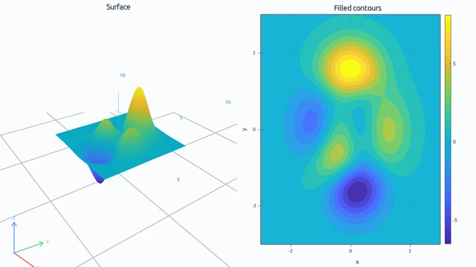

# Draw one field as a surface and as filled contours side by side

[](https://runmat.com/sandbox?example=plotting-surface-and-contours)

This example draws the same two-variable field twice in one figure with `subplot`: as a shaded
3-D surface with `surf` on the left and as 16 filled contour bands with `contourf` on the right.
The field, the standard test function also available as `peaks`, reaches 8.09 at its
highest point and −6.54 at its lowest on this 80 × 80 grid.

<picture>
  <source media="(prefers-color-scheme: dark)" srcset=".artifacts/thumbnail.webp">
  
</picture>

## The problem

Surfaces and contour maps answer different questions about the same data. The surface gives the
shape at a glance: how many peaks, how sharp, which way the slopes run. The filled contour map
gives locations and values that can be read off, with nothing hidden behind a peak. Showing both
side by side is a common layout in reports for response surfaces, terrain and computed fields.

The field is a sum of Gaussian bumps shaped by polynomials:

```matlab
Z = 3*(1 - X).^2 .* exp(-X.^2 - (Y + 1).^2) - 10*(X/5 - X.^3 - Y.^5) .* exp(-X.^2 - Y.^2) ...
    - exp(-(X + 1).^2 - Y.^2)/3;
```

## How the example works

1. **Sample the field** on an 80 × 80 grid from −3 to 3:

   ```matlab
   [X, Y] = meshgrid(linspace(-3, 3, 80));
   ```

2. **Draw the surface in the left panel**:

   ```matlab
   subplot(1, 2, 1);
   surf(X, Y, Z);
   shading interp;
   view(-35, 30);
   ```

3. **Draw the filled contours in the right panel** with a color bar:

   ```matlab
   subplot(1, 2, 2);
   contourf(X, Y, Z, 16);
   colorbar;
   ```

## Results

Both panels show the same peaks and pits. The tallest peak, 8.09 at about
(−0.04, 1.56), is the bright yellow region near the top of the contour map, and the deepest pit,
−6.54 at about (0.19, −1.63), is the dark blue region near the bottom. These extremes were computed
from the formula on the same grid.

## What to try

1. Replace the formula with `Z = peaks(X, Y)` and confirm the plot is unchanged.
2. Add `hold on; contour(X, Y, Z, 16, 'k')` in the right panel to outline the bands.
3. Use `subplot(2, 1, k)` to stack the panels for a portrait page.

## Files

- `surface-and-contours.m`: the script: the three-peak field, the surface and the filled contours.
- `runmat.toml`: the project file.

## Related

- [Plotting in RunMat](https://runmat.com/math/plotting)
- [Plotting guide](https://runmat.com/docs/runtime/plotting)
- [Surface with contours](../surfc) and [four-panel summary](../subplot-summary)
- Function reference: [`subplot`](https://runmat.com/docs/reference/builtins/subplot), [`surf`](https://runmat.com/docs/reference/builtins/surf), [`contourf`](https://runmat.com/docs/reference/builtins/contourf)
- [Download RunMat](https://runmat.com/download)
