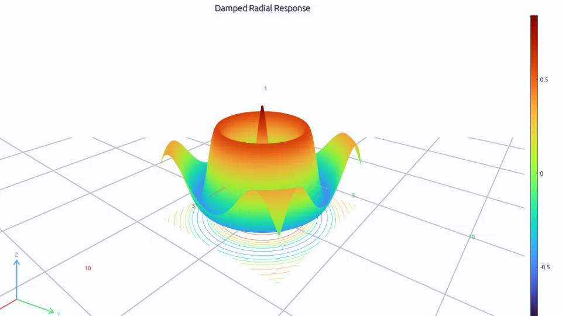

# Shaded surface with a contour map beneath it using surfc

[](https://runmat.com/sandbox?example=plotting-surfc)

This example draws a damped radial response, cos(2.5r)·e^(−0.22r), as a shaded surface with
`surfc`, which adds a contour map below the surface. By the formula the response is 0.90 at the center, and it
alternates between rings of crests and troughs that shrink outward.

<picture>
  <source media="(prefers-color-scheme: dark)" srcset=".artifacts/thumbnail.webp">
  
</picture>

## The problem

`surfc` combines a surface with its contours projected on the floor of the plot, so the shape and
the readable level lines appear in one view. It suits fields with rings or ridges where the
contours show positions more clearly than the shaded surface: a vibrating plate's mode shape, a
wave spreading from a source, or a response surface with several optima.

The response is a radial cosine with an exponential decay. The 0.15 offset in the radius keeps the
center smooth:

```matlab
R = sqrt(X.^2 + Y.^2) + 0.15;
Z = cos(2.5*R).*exp(-0.22*R);
```

## How the example works

1. **Sample the response** on a 120 × 120 grid from −4 to 4:

   ```matlab
   [X, Y] = meshgrid(linspace(-4, 4, 120), linspace(-4, 4, 120));
   ```

2. **Draw the surface and its contours** in one call, with interpolated shading:

   ```matlab
   surfc(X, Y, Z);
   shading interp;
   colormap('turbo');
   colorbar;
   view(38, 27);
   ```

## Results

By the formula, the first trough is −0.76 at R = 1.26 and the next crest 0.58 at R = 2.51, where R
includes the 0.15 offset. In the figure that crest forms a raised orange wall around the center,
the first trough sits hidden inside it, and the contour rings on the floor mark each crest and
trough as concentric circles.

## What to try

1. Raise the decay from 0.22 to 0.6 and look at how quickly the rings fade.
2. Swap `surfc` for [meshc](../meshc) to see the same layout as a wireframe.
3. Look from above with `view(0, 90)` to compare the shading with the contour rings.

## Files

- `surfc.m`: the script: the damped radial response and the surfc plot.
- `runmat.toml`: the project file.

## Related

- [Plotting in RunMat](https://runmat.com/math/plotting)
- [Plotting guide](https://runmat.com/docs/runtime/plotting)
- [Surface plot](../surf) and [mesh with contours](../meshc)
- Function reference: [`surfc`](https://runmat.com/docs/reference/builtins/surfc), [`surf`](https://runmat.com/docs/reference/builtins/surf), [`contour`](https://runmat.com/docs/reference/builtins/contour)
- [Download RunMat](https://runmat.com/download)
