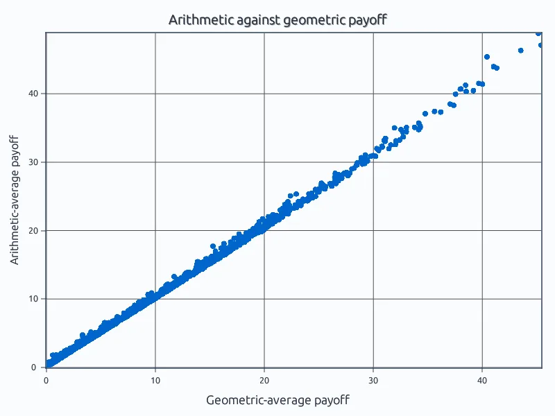

# Pricing an arithmetic Asian option by Monte Carlo with a geometric control variate

[](https://runmat.com/sandbox?example=quant-asian-control-variate)

This example prices a one-year arithmetic-average Asian call, monitored daily, by Monte Carlo over
100,000 paths, and uses the geometric-average Asian call, which has a closed form, as a control
variate. The plain estimate is 5.7730 with a standard error of 0.0253. The control variate gives
5.7814 with a standard error of 0.0007, a variance 1334 times smaller from the same paths.

<picture>
  <source media="(prefers-color-scheme: dark)" srcset=".artifacts/thumbnail.webp">
  
</picture>

## The problem

An Asian option pays on the average price of the underlying over its life, which makes it cheaper
than a vanilla option and harder to manipulate at expiry. The arithmetic average of lognormal
prices has no closed-form distribution, so the arithmetic Asian call is usually priced by Monte
Carlo. Plain Monte Carlo converges slowly: the standard error falls as 1/√n, so each extra digit
costs 100 times the paths.

A control variate fixes that cheaply. The geometric average of lognormal prices is itself
lognormal, so the geometric Asian call has an exact price. Its payoff moves almost one for one with
the arithmetic payoff, path by path. The control variate estimator subtracts the known error of
the geometric estimate:

$$\hat{C}_{cv} = \bar{C}_{arith} - b\left(\bar{C}_{geo} - C_{geo}^{exact}\right), \qquad b = \frac{\operatorname{cov}(C_{arith}, C_{geo})}{\operatorname{var}(C_{geo})}$$

The variance falls by the factor 1/(1 − ρ²), where ρ is the correlation between the two payoffs.

## How the example works

1. **Simulate 100,000 paths** of geometric Brownian motion over 252 daily steps, with S₀ = K = 100,
   r = 5 % and σ = 20 %:

   ```matlab
   incr = (r - 0.5*sigma^2)*dt + sigma*sqrt(dt)*randn(n, N);
   logS = log(S0) + cumsum(incr, 2);
   ```

2. **Compute both discounted payoffs** on every path:

   ```matlab
   arith = exp(-r*T) * max(mean(exp(logS), 2) - K, 0);
   geo = exp(-r*T) * max(exp(mean(logS, 2)) - K, 0);
   ```

3. **Price the geometric option exactly.** For discrete monitoring, the geometric average is
   lognormal with an adjusted volatility and drift, and a Black-Scholes-type formula prices it:

   ```matlab
   sg = sigma * sqrt((N + 1)*(2*N + 1) / (6*N^2));
   geo_exact = exp(-r*T) * (S0*exp(mg*T)*normcdf(d1) - K*normcdf(d1 - sg*sqrt(T)));
   ```

4. **Apply the control variate** with the regression coefficient b estimated from the same paths:

   ```matlab
   c = cov(arith, geo);  b = c(1, 2) / c(2, 2);
   adjusted = arith - b * (geo - geo_exact);
   ```

5. **Plot** the arithmetic payoff against the geometric payoff for the first 3,000 paths.

## Results

```
plain estimate 5.7730, standard error 0.0253
with the control variate 5.7814, standard error 0.0007 (variance 1334 times smaller)
```

The scatter shows the two payoffs lying almost on one line, with the arithmetic payoff slightly
above the geometric one, since an arithmetic average is never below a geometric average. A
variance 1334 times smaller cuts the standard error by a factor of 36.5, which plain Monte Carlo
would need 1334 times as many paths to match. The geometric option's exact price, from the closed
form above, is 5.5655, so the arithmetic option is worth 0.2159 more.

## What to try

1. Cut the paths to `n = 1000`. Standard errors scale as 1/√n, so both grow about tenfold; compare
   how far each estimate moves from its 100,000-path value.
2. Raise the volatility to `sigma = 0.4` and look at how the variance reduction changes as the two
   averages drift further apart.
3. Monitor weekly with `N = 52` and compare the price; fewer averaging dates leave the average more
   volatile.

## Files

- `asian-control-variate.m`: the script: path simulation, both payoffs, the geometric closed form, the control variate and the scatter plot.
- `runmat.toml`: the project file.

## Related

- [Quantitative finance in RunMat](https://runmat.com/industries/quant)
- [European call by Monte Carlo](../european-call): plain Monte Carlo checked against Black-Scholes
- Function reference: [`randn`](https://runmat.com/docs/reference/builtins/randn), [`cumsum`](https://runmat.com/docs/reference/builtins/cumsum), [`cov`](https://runmat.com/docs/reference/builtins/cov), [`normcdf`](https://runmat.com/docs/reference/builtins/normcdf)
- [Download RunMat](https://runmat.com/download)
