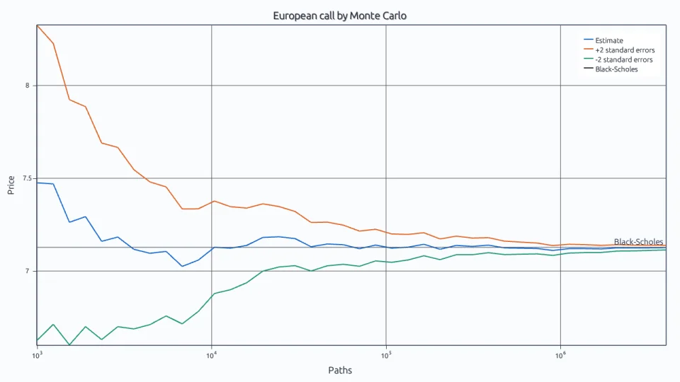

# Pricing a European call by Monte Carlo and checking it against Black-Scholes

[](https://runmat.com/sandbox?example=quant-european-call)

This example prices a one-year European call, strike 105 on a stock at 100, by simulating four
million terminal prices under geometric Brownian motion and averaging the discounted payoff. The
Monte Carlo price is 7.1266 with a standard error of 0.0063. The Black-Scholes price is 7.1281,
0.2 standard errors away.

<picture>
  <source media="(prefers-color-scheme: dark)" srcset=".artifacts/thumbnail.webp">
  
</picture>

## The problem

Monte Carlo is the general-purpose pricing method for derivatives whose payoffs depend on paths,
several assets or features with no closed form. Before trusting it on those, a quant checks the
simulation on a case with a known answer. The European call under Black-Scholes is that case:

$$C = S_0 N(d_1) - K e^{-rT} N(d_2), \qquad d_{1,2} = \frac{\ln(S_0/K) + (r \pm \sigma^2/2)T}{\sigma\sqrt{T}}$$

Under the risk-neutral measure the terminal price is lognormal,

$$S_T = S_0 \exp\left[\left(r - \tfrac{1}{2}\sigma^2\right)T + \sigma\sqrt{T}\,Z\right], \qquad Z \sim N(0, 1)$$

so one normal draw per path is enough. The price is the mean discounted payoff, and its standard
error, the sample standard deviation over √n, says how far the estimate can be trusted. Here
S₀ = 100, K = 105, r = 3 %, σ = 20 % and T = 1 year.

## How the example works

1. **Draw the terminal prices** for four million paths in one vectorized step:

   ```matlab
   Z = randn(n, 1);
   ST = S0 * exp((r - 0.5*sigma^2)*T + sigma*sqrt(T)*Z);
   ```

2. **Average the discounted payoff** and compute its standard error:

   ```matlab
   payoff = exp(-r*T) * max(ST - K, 0);
   price = mean(payoff);
   se = std(payoff) / sqrt(n);
   ```

3. **Compare with Black-Scholes** and express the gap in standard errors:

   ```matlab
   bs = blsprice(S0, K, r, T, sigma);
   gap = abs(price - bs) / se;
   ```

4. **Plot the convergence**: the estimate and its ±2 standard error band from the first 1,000 paths
   to all four million, at 40 log-spaced path counts, with the Black-Scholes price as a line.

## Results

```
Monte Carlo 7.1266, standard error 0.0063
Black-Scholes 7.1281, 0.2 standard errors away
```

A gap of 0.2 standard errors is well within the range expected from sampling noise, so the
simulation agrees with the closed form. The plot shows the estimate wandering by several tenths
over the first few thousand paths, with a band wide enough to contain the Black-Scholes price.
The band narrows as 1/√n: from 1,000 to four million paths it shrinks by a factor of about 63, and
the estimate settles onto the Black-Scholes line.

## What to try

1. Raise the volatility to `sigma = 0.3`. The Black-Scholes price rises to 11.1117; check that the
   Monte Carlo estimate follows within a few standard errors.
2. Add antithetic variates: use `Z = [Z0; -Z0]` with `Z0 = randn(n/2, 1)` and compare the standard
   error for the same number of paths. Compute it from pair averages, since the two halves are
   correlated.
3. Change the seed in `rng(42)` several times and record the gap in standard errors; most runs
   should land within 2.

## Files

- `european-call.m`: the script: path simulation, Monte Carlo price, Black-Scholes check and the convergence plot.
- `runmat.toml`: the project file.

## Related

- [Quantitative finance in RunMat](https://runmat.com/industries/quant)
- [Asian option with a control variate](../asian-control-variate): cutting Monte Carlo error with a known closed form
- [Heston volatility surface](../heston-surface): Monte Carlo under stochastic volatility
- Function reference: [`blsprice`](https://runmat.com/docs/reference/builtins/blsprice), [`randn`](https://runmat.com/docs/reference/builtins/randn), [`std`](https://runmat.com/docs/reference/builtins/std), [`semilogx`](https://runmat.com/docs/reference/builtins/semilogx)
- [Download RunMat](https://runmat.com/download)
