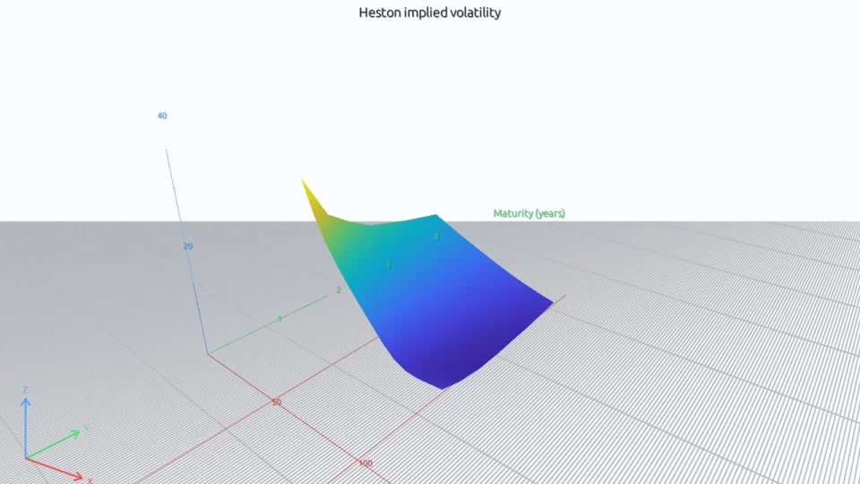

# Heston model implied volatility surface by Monte Carlo

[](https://runmat.com/sandbox?example=quant-heston-surface)

This example simulates the Heston stochastic volatility model over two years with 50,000 paths,
prices European calls at 13 strikes and 6 maturities from the same paths, and inverts each price to
a Black-Scholes implied volatility. The one-year at-the-money implied volatility is 18.6 %. The
skew runs from 26.1 % at the 70 strike down to 13.9 % at the 130 strike.

<picture>
  <source media="(prefers-color-scheme: dark)" srcset=".artifacts/thumbnail.webp">
  
</picture>

## The problem

Black-Scholes assumes one constant volatility, but option markets quote different implied
volatilities for different strikes and maturities. Equity index options show a skew: low strikes
carry higher implied volatility than high strikes. The Heston model reproduces this with a
variance that follows its own mean-reverting process and moves against the stock price:

$$dS = r S\,dt + \sqrt{v}\,S\,dW_1, \qquad dv = \kappa(\theta - v)\,dt + \xi\sqrt{v}\,dW_2, \qquad dW_1\,dW_2 = \rho\,dt$$

The parameters here are a starting and long-run variance of 0.04 (20 % volatility), mean reversion
κ = 2, volatility of variance ξ = 0.5, and correlation ρ = −0.7. The negative correlation makes
volatility rise when the price falls, which fattens the left tail of the return distribution and
produces the skew. Quants calibrate these parameters to market quotes and then price exotic
options consistently with the vanilla surface.

## How the example works

1. **Draw correlated shocks** each step, with ρ = −0.7 between the price and variance shocks:

   ```matlab
   z1 = randn(n, 1);
   z2 = rho*z1 + sqrt(1 - rho^2)*randn(n, 1);
   ```

2. **Step the log price and the variance** with an Euler scheme on a 1/120-year grid. The variance
   can go negative in a discrete step, so the update uses its positive part, a scheme known as full
   truncation:

   ```matlab
   vp = max(v, 0);
   x = x + (r - 0.5*vp)*dt + sqrt(vp*dt).*z1;
   v = v + kappa*(theta - vp)*dt + xi*sqrt(vp*dt).*z2;
   ```

   With these parameters 2κθ = 0.16 is below ξ² = 0.25, so the Feller condition fails and the
   continuous variance process itself can reach zero.

3. **Price at each maturity** of 0.25, 0.5, 0.75, 1, 1.5 and 2 years, when the simulation passes
   it, for strikes 70 to 130 in steps of 5:

   ```matlab
   price = exp(-r*mats(row)) * mean(max(ST - K(c), 0));
   ```

4. **Invert to implied volatility** with `blsimpv` and draw the surface with `surf`:

   ```matlab
   surface(row, c) = blsimpv(S0, K(c), r, mats(row), price);
   ```

## Results

```
one-year at-the-money implied volatility 18.6%
one-year skew: 26.1% at the 70 strike, 13.9% at the 130 strike
```

The at-the-money level sits below the 20 % volatility of the starting variance. In the Heston
model, negative correlation and a high volatility of variance both pull at-the-money implied
volatility below the square root of the variance. The skew spans 12.2 volatility points across the
strike range at one year.

The surface shows how the skew changes with maturity. In the captured run, the spread from the 70
to the 130 strike is 36.0 % to 15.2 % at three months and 23.4 % to 15.1 % at two years. The skew
flattens with maturity because mean reversion pulls each path's variance back toward θ, which
averages out the effect of the correlation over longer horizons.

## What to try

1. Set `rho = 0` and rerun, then compare the implied volatilities at the 70 and 130 strikes with
   the skewed values above.
2. Lower the volatility of variance to `xi = 0.2` and look at how much of the skew remains.
3. Raise `n` to 200,000 to reduce the Monte Carlo noise, most visible at the far strikes of the
   shortest maturity, where few paths finish in the money.

## Files

- `heston-surface.m`: the script: Heston simulation, prices across strikes and maturities, implied volatility inversion and the surface plot.
- `runmat.toml`: the project file.

## Related

- [Quantitative finance in RunMat](https://runmat.com/industries/quant)
- [Implied volatility smile](../vol-smile): implied volatility across strikes from one maturity
- [European call by Monte Carlo](../european-call): the constant-volatility case checked against Black-Scholes
- Function reference: [`blsimpv`](https://runmat.com/docs/reference/builtins/blsimpv), [`randn`](https://runmat.com/docs/reference/builtins/randn), [`surf`](https://runmat.com/docs/reference/builtins/surf)
- [Download RunMat](https://runmat.com/download)
