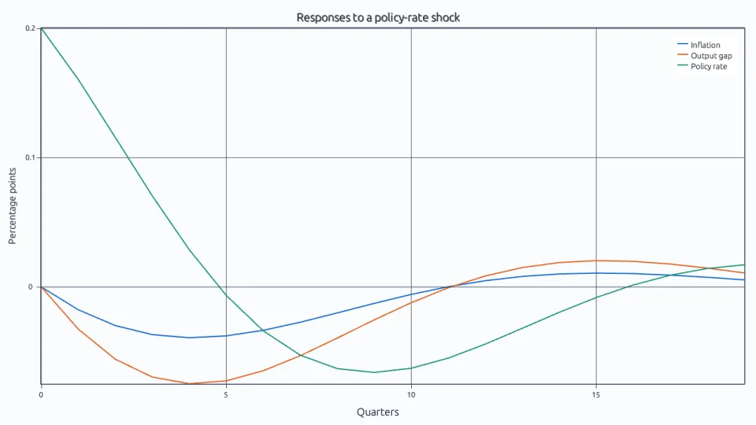

# Impulse responses to a monetary policy shock from a VAR(1)

[](https://runmat.com/sandbox?example=quant-policy-shock)

This example estimates a first-order vector autoregression (VAR) in inflation, the output gap and
the policy rate by least squares on 400 quarters of data, then traces how all three respond to a
policy-rate shock over 20 quarters. The estimated coefficients are within 0.087 of the true model.
A rate shock lowers inflation most after 4 quarters, by 0.039 percentage points.

<picture>
  <source media="(prefers-color-scheme: dark)" srcset=".artifacts/thumbnail.webp">
  
</picture>

## The problem

Central bank economists and macro strategists ask how inflation and output react when the policy
rate rises unexpectedly, and how long the effect takes to arrive. A VAR models each variable as a
linear function of the previous quarter's values of all of them:

$$y_t = A\,y_{t-1} + u_t, \qquad y_t = \begin{bmatrix} \pi_t & x_t & i_t \end{bmatrix}^\top$$

with inflation π, output gap x and policy rate i. The residuals u_t are correlated across the three
equations, so a "rate shock" needs an identification assumption. The recursive (Cholesky)
identification used here orders the rate last: a rate shock moves only the rate in its first
quarter, and inflation and output respond from the next quarter on. The impulse response at
horizon k is A^k times the shock vector.

The data are simulated from a known A and shock matrix, so the estimate can be checked against the
truth.

## How the example works

1. **Simulate 400 quarters** from the true model:

   ```matlab
   A = [0.7 0.1 -0.1; 0.2 0.8 -0.15; 0.3 0.2 0.8];
   Y(t, :) = (A * Y(t-1, :)' + S * randn(3, 1))';
   ```

2. **Estimate A by least squares**, regressing each quarter on the previous one with the backslash
   operator:

   ```matlab
   X = Y(1:end-1, :);
   Ahat = (X \ Y(2:end, :))';
   ```

3. **Identify the rate shock** from the lower Cholesky factor of the residual covariance; its third
   column is a one-standard-deviation rate shock:

   ```matlab
   P = chol(cov(res), 'lower');
   shock = P(:, 3);
   ```

4. **Propagate the shock** through the estimated model for 20 quarters and plot all three
   responses:

   ```matlab
   irf(k, :) = shock';
   shock = Ahat * shock;
   ```

## Results

```
largest coefficient error 0.087 against the true model
a rate shock lowers inflation most after 4 quarters, by 0.039 points
```

The plot starts with the policy rate 0.2 points higher and inflation and the output gap at zero,
as the identification requires. The output gap falls faster and further than inflation, and both
reach their lowest point after 4 quarters. The rate falls back through zero after about five
quarters and undershoots, as the policy equation's response to weaker inflation and output pulls
it down. All three responses cross zero again in the second half of the 20 quarters and shrink toward
zero.

The 0.087 coefficient error is sampling error from 400 quarters of noisy data. The impulse
responses are built from the estimated coefficients, so they carry that error too; a shorter
sample would widen it.

## What to try

1. Simulate 4000 quarters with `T = 4000` and compare the largest coefficient error with 0.087.
2. Trace an output-gap shock instead with `shock = P(:, 2)` and see how the policy rate responds.
3. Make the rate respond more strongly to inflation by raising `A(3, 1)` from 0.3 to 0.5, and look at
   how the inflation response changes.

## Files

- `policy-shock.m`: the script: simulated data, least-squares VAR, Cholesky identification, impulse responses and the plot.
- `runmat.toml`: the project file.

## Related

- [Quantitative finance in RunMat](https://runmat.com/industries/quant)
- [Yield curve fit](../yield-curve): the term structure the policy rate anchors
- Function reference: [`chol`](https://runmat.com/docs/reference/builtins/chol), [`cov`](https://runmat.com/docs/reference/builtins/cov), [`mldivide`](https://runmat.com/docs/reference/builtins/mldivide)
- [Download RunMat](https://runmat.com/download)
