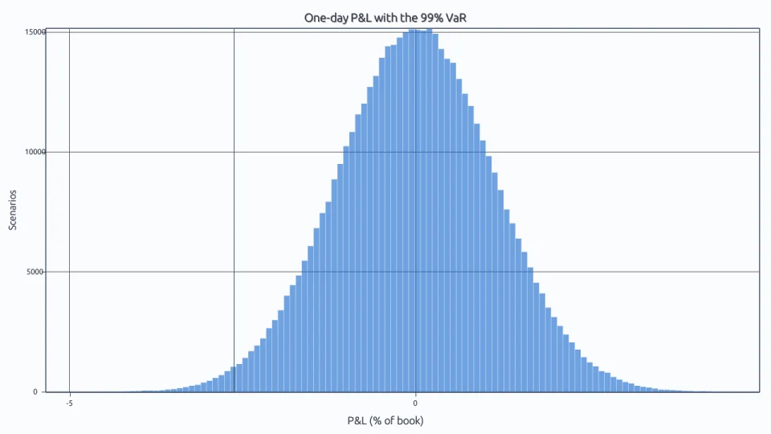

# Monte Carlo value at risk and expected shortfall for a correlated portfolio

[](https://runmat.com/sandbox?example=quant-portfolio-var)

This example computes the one-day 99 % value at risk (VaR) and expected shortfall (ES) of a
three-asset portfolio from 500,000 correlated return scenarios. The simulated VaR is 2.625 % of the
book and the ES is 3.000 %, against 2.625 % and 3.008 % from the normal closed forms.

<picture>
  <source media="(prefers-color-scheme: dark)" srcset=".artifacts/thumbnail.webp">
  
</picture>

## The problem

Risk managers report how much a portfolio can lose over a short horizon. The 99 % one-day VaR is
the loss exceeded on 1 day in 100. Expected shortfall is the average loss on those worst days, so
it also measures how bad the tail is; the Basel market risk framework (FRTB) uses ES at 97.5 % for
capital.

The portfolio holds 50 %, 30 % and 20 % in three assets with daily volatilities of 1.2 %, 2.0 % and
0.8 % and correlations between 0.2 and 0.6. Its return variance is w'Σw, where the covariance
matrix Σ combines the volatilities and the correlation matrix. For normal returns, VaR and ES have
closed forms in the portfolio volatility σ_p:

$$\text{VaR}_{99} = z_{0.99}\,\sigma_p, \qquad \text{ES}_{99} = \sigma_p \frac{\varphi(z_{0.99})}{0.01}$$

where z₀.₉₉ = 2.326 is the 99 % normal quantile and φ is the standard normal density. Monte Carlo
gives the same numbers here, which checks the simulation; the same code then carries over to
fat-tailed returns or nonlinear positions, where no closed form exists.

## How the example works

1. **Build the covariance matrix** from the volatilities and correlations:

   ```matlab
   Sigma = (vol * vol') .* C;
   ```

2. **Generate correlated scenarios.** Multiplying independent normals by the Cholesky factor of Σ
   gives returns with covariance Σ:

   ```matlab
   returns = randn(500000, 3) * chol(Sigma);
   pnl = returns * w;
   ```

3. **Read VaR and ES** from the simulated P&L: VaR is the 1st percentile loss, and ES is the mean of
   the losses beyond it:

   ```matlab
   var99 = -prctile(pnl, 1);
   es99 = -mean(pnl(pnl <= -var99));
   ```

4. **Compare with the closed forms**, using `norminv` and `normpdf`, and plot a 120-bin histogram
   of the P&L with the VaR marked by `xline`.

## Results

```
99% VaR 2.625% of the book (normal theory 2.625%)
99% expected shortfall 3.000% (normal theory 3.008%)
```

The portfolio's daily volatility is 1.129 %. The simulated VaR matches the closed form to the
printed precision, and the ES falls 0.008 points short, a sampling difference: only the worst 5,000
of the 500,000 scenarios enter the ES average. The weighted sum of the three assets' own VaRs is
3.164 %, so correlations below 1 lower the portfolio VaR by 0.538 points. The
histogram shows a symmetric bell around zero, with the VaR line in the left tail.

## What to try

1. Set every correlation to zero in `C`. The closed-form VaR falls to 2.009 %.
2. Compute the 97.5 % ES with `prctile(pnl, 2.5)` in place of the 1st percentile. The normal
   closed form gives 2.638 %, within 0.013 points of the 99 % VaR.
3. Replace `randn` with fat-tailed draws, for example normals scaled by a random volatility per
   scenario, and see how far the simulated VaR and ES move from the normal closed forms.

## Files

- `portfolio-var.m`: the script: covariance, correlated scenarios, VaR, ES, closed-form check and the histogram.
- `runmat.toml`: the project file.

## Related

- [Quantitative finance in RunMat](https://runmat.com/industries/quant)
- [European call by Monte Carlo](../european-call): another Monte Carlo estimate checked against a closed form
- Function reference: [`chol`](https://runmat.com/docs/reference/builtins/chol), [`prctile`](https://runmat.com/docs/reference/builtins/prctile), [`norminv`](https://runmat.com/docs/reference/builtins/norminv), [`histogram`](https://runmat.com/docs/reference/builtins/histogram)
- [Download RunMat](https://runmat.com/download)
