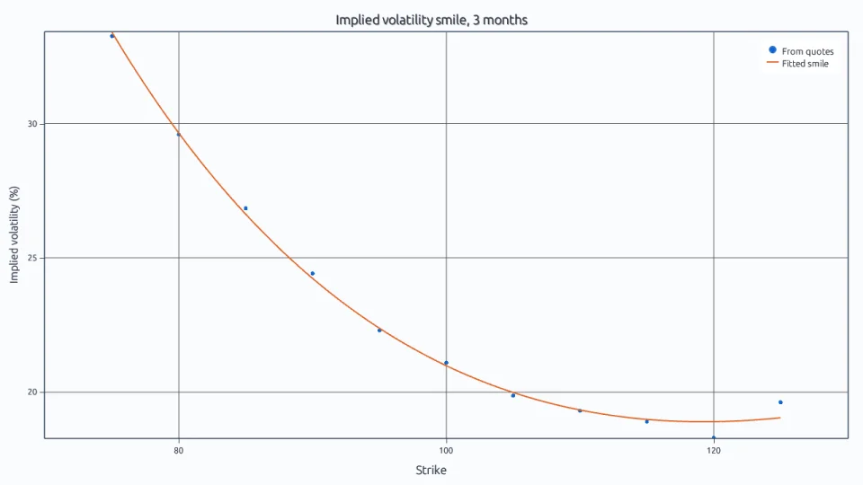

# Implied volatility smile from option quotes with a quadratic fit

[](https://runmat.com/sandbox?example=quant-vol-smile)

This example inverts eleven three-month call quotes, strikes 75 to 125, to Black-Scholes implied
volatilities and fits a quadratic smile in log-moneyness through them. The quotes are rounded to the
nearest 0.05, as a trading screen shows them. The fitted at-the-money volatility is 21.0 %, with
24.2 % at the 90 strike and 19.3 % at the 110 strike, a skew of 4.9 points.

<picture>
  <source media="(prefers-color-scheme: dark)" srcset=".artifacts/thumbnail.webp">
  
</picture>

## The problem

Options desks quote prices as volatilities. The implied volatility of an option is the σ that makes
the Black-Scholes price equal the market price, and plotting it across strikes for one expiry gives
the smile, or for equities the skew: low strikes trade at higher implied volatility. A smooth curve
through the quotes lets a desk price strikes that are not quoted, mark a book consistently and
read off summary numbers such as the at-the-money level and the 90–110 skew.

A simple parameterization is a quadratic in log-moneyness m = ln(K/S₀):

$$\sigma(m) = a_0 + a_1 m + a_2 m^2$$

The quotes in this example come from a known smile, σ(m) = 0.21 − 0.25 m + 0.6 m², with S₀ = 100,
r = 2 % and T = 0.25 years. Rounding each price to 0.05 adds the kind of error a real quote has, and
that error matters most for far out-of-the-money options, whose prices are only a few cents.

## How the example works

1. **Make the quotes.** Price each strike with the true smile and round to the nearest 0.05:

   ```matlab
   true_vol = 0.21 - 0.25*m + 0.6*m.^2;
   quotes = round(blsprice(S0, K, r, T, true_vol) / 0.05) * 0.05;
   ```

2. **Invert to implied volatility** for each quote:

   ```matlab
   iv = blsimpv(S0, K, r, T, quotes);
   ```

3. **Fit the quadratic** in log-moneyness and evaluate it at the money and at the 90 and 110
   strikes:

   ```matlab
   coef = polyfit(m, iv, 2);
   polyval(coef, 0)
   ```

4. **Plot** the implied volatilities from the quotes and the fitted curve against strike.

## Results

```
at-the-money implied volatility 21.0%
90 strike 24.2%, 110 strike 19.3%: a skew of 4.9 points
```

The true smile gives 21.0 % at the money, 24.3 % at 90 and 19.2 % at 110, a skew of 5.1 points, so
the fit recovers the level and lands 0.2 points low on the skew. Most points sit on the fitted
curve. The two highest strikes do not: the 120 call is worth 0.105 and its quote rounds down to
0.10, and the 125 call is worth 0.031 and rounds up to 0.05. At those prices the largest rounding
error, 0.025, is worth 0.73 and 1.87 volatility points (the price error divided by vega), against
0.13 points at the money. The figure shows the 125 point well above the curve and the 120 point
below it.

## What to try

1. Quote to the nearest 0.01 instead of 0.05. The largest rounding error falls to 0.005, worth at
   most 0.15 and 0.37 volatility points at the 120 and 125 strikes.
2. Drop the two highest strikes with `K = (75:5:115)'` and compare the fitted skew with the true
   5.1 points.
3. Weight the fit by vega, so that strikes whose prices carry more information about volatility
   count more, and compare the fitted at-the-money level.

## Files

- `vol-smile.m`: the script: quotes from a known smile, implied volatility inversion, quadratic fit and the plot.
- `runmat.toml`: the project file.

## Related

- [Quantitative finance in RunMat](https://runmat.com/industries/quant)
- [Heston volatility surface](../heston-surface): a smile across maturities from a stochastic volatility model
- Function reference: [`blsimpv`](https://runmat.com/docs/reference/builtins/blsimpv), [`blsprice`](https://runmat.com/docs/reference/builtins/blsprice), [`polyfit`](https://runmat.com/docs/reference/builtins/polyfit), [`polyval`](https://runmat.com/docs/reference/builtins/polyval)
- [Download RunMat](https://runmat.com/download)
