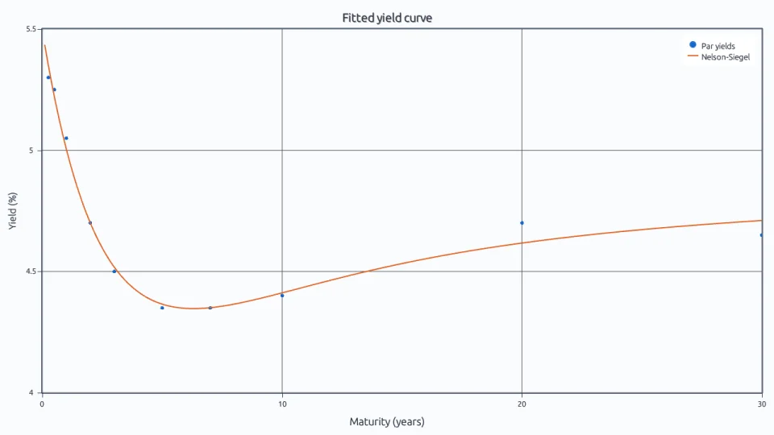

# Fitting a Nelson-Siegel yield curve to par yields

[](https://runmat.com/sandbox?example=quant-yield-curve)

This example fits the four-parameter Nelson-Siegel curve to ten par yields from 3 months to
30 years by nonlinear least squares. The fit gives a level of 4.90 %, a slope of 0.60 %, a
curvature of −2.70 % and a decay time of 2.7 years. The largest miss across the ten maturities is
8.3 basis points.

<picture>
  <source media="(prefers-color-scheme: dark)" srcset=".artifacts/thumbnail.webp">
  
</picture>

## The problem

Bonds trade at a handful of maturities, but pricing, risk and relative-value work need a yield at
every maturity. A fitted curve fills the gaps with a smooth shape that also summarizes the market
in a few numbers. Nelson-Siegel is the standard parsimonious form, and many central banks use it
or its Svensson extension to publish their curves:

$$y(t) = \beta_1 + \beta_2 \frac{1 - e^{-t/\tau}}{t/\tau} + \beta_3 \left( \frac{1 - e^{-t/\tau}}{t/\tau} - e^{-t/\tau} \right)$$

Each parameter has a market meaning. β₁ is the long-run level the curve approaches. β₂ is the
slope: the short end sits at β₁ + β₂, so a positive β₂ means short rates above long rates. β₃ is
the curvature, a hump (positive) or a dip (negative) in the middle maturities. τ sets where along
the curve the slope and curvature act.

The input curve here is inverted at the front, from 5.30 % at 3 months down to 4.35 % at 5 and
7 years, and rises again to 4.70 % at 20 years.

## How the example works

1. **Enter the maturities and par yields**:

   ```matlab
   mat = [0.25 0.5 1 2 3 5 7 10 20 30]';
   y = [5.30 5.25 5.05 4.70 4.50 4.35 4.35 4.40 4.70 4.65]' / 100;
   ```

2. **Write the curve** as an anonymous function of the parameters `b = [β₁ β₂ β₃ τ]`:

   ```matlab
   ns = @(b, t) b(1) + b(2)*(1 - exp(-t/b(4)))./(t/b(4)) + b(3)*((1 - exp(-t/b(4)))./(t/b(4)) - exp(-t/b(4)));
   ```

3. **Fit by nonlinear least squares** on the yield residuals, starting from a 4.5 % level and a
   2-year decay time:

   ```matlab
   b = lsqnonlin(@(b) ns(b, mat) - y, [0.045 0.01 -0.01 2]);
   ```

4. **Plot** the par yields and the fitted curve from 0.1 to 30 years.

## Results

```
level 4.90%, slope 0.60%, curvature -2.70%, decay 2.7 years
largest miss 8.3 basis points across 10 maturities
```

The fitted curve starts at β₁ + β₂ = 5.50 % at the short end, falls to a minimum of about 4.35 %
near 6.3 years, and climbs toward the 4.90 % level, reaching 4.71 % at 30 years. The negative
curvature produces that dip. In the figure, the largest misses are at the long end, where the
curve passes below the 20-year yield and above the 30-year yield: four parameters cannot follow
the market's small drop from 20 to 30 years. The Svensson form adds a second curvature term for
this.

## What to try

1. Start the fit from a different decay time, `[0.045 0.01 -0.01 6]`, and compare the fitted
   parameters and the largest miss.
2. Fix the decay time at 2.7 years and fit only β₁, β₂ and β₃. With τ fixed the model is linear, and
   `mldivide` solves it without iteration.
3. Add a fifth parameter and a second curvature term with its own decay time (the Svensson
   extension) and compare the largest miss.

## Files

- `yield-curve.m`: the script: par yields, the Nelson-Siegel curve, the least-squares fit and the plot.
- `runmat.toml`: the project file.

## Related

- [Quantitative finance in RunMat](https://runmat.com/industries/quant)
- [Yield curves through a cycle](../yield-curves): ten years of curves through hikes, inversion and cuts
- Function reference: [`lsqnonlin`](https://runmat.com/docs/reference/builtins/lsqnonlin), [`exp`](https://runmat.com/docs/reference/builtins/exp), [`plot`](https://runmat.com/docs/reference/builtins/plot)
- [Download RunMat](https://runmat.com/download)
