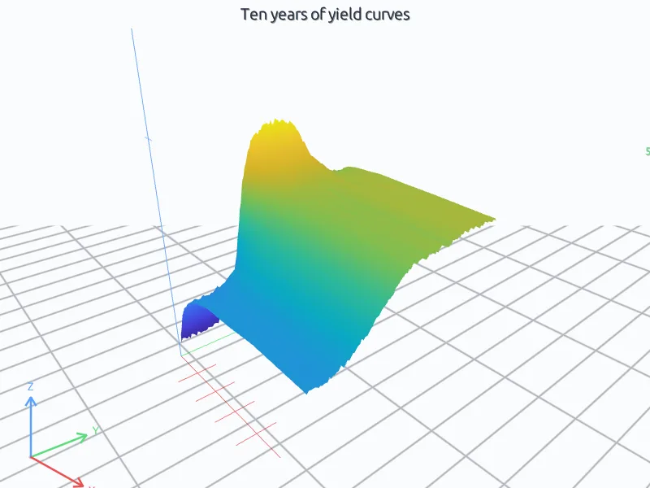

# Yield curves through a rate cycle: the 2s10s spread and curve inversion

[](https://runmat.com/sandbox?example=quant-yield-curves)

This example builds ten years of month-end yield curves, 3 months to 30 years, through a full
policy cycle: rates near zero, a hiking cycle that inverts the curve, then cuts that steepen it
again. It tracks the 2s10s spread, the 10-year yield minus the 2-year. The spread ranges from
+0.93 points at its steepest to −0.70 points at its deepest inversion, and the curve is inverted
in 51 of the 120 months.

<picture>
  <source media="(prefers-color-scheme: dark)" srcset=".artifacts/thumbnail.webp">
  
</picture>

## The problem

The yield curve changes shape through a monetary policy cycle. The short end follows the policy
rate. The long end follows expectations of where rates settle over decades. When a central bank
hikes above that long-run level, short yields rise above long ones and the curve inverts. The
2s10s spread is the usual summary of that shape, and an inverted curve is widely watched as a
recession signal. Rates strategists and risk managers plot the whole history at once to see
how the curve moved between dates.

Each curve here blends the policy rate and a long-run rate with a weight that decays with
maturity t, plus a hump in the middle maturities while the curve is inverted:

$$y(t) = r_{policy}\, e^{-t/\lambda} + r_{long}\left(1 - e^{-t/\lambda}\right) + \text{hump}, \qquad \lambda = 2.5 \text{ years}$$

## How the example works

1. **Set the policy path.** Two logistic steps take the rate from 0.25 % up by 4.75 points around
   month 45, then down by 1.75 points around month 95:

   ```matlab
   policy = 0.25 + 4.75 ./ (1 + exp(-(t - 45)/5)) - 1.75 ./ (1 + exp(-(t - 95)/4));
   ```

2. **Set the long-run rate**, rising from 2.0 % by 1.6 points around month 40, with a small random
   walk on top:

   ```matlab
   longrun = 2.0 + 1.6 ./ (1 + exp(-(t - 40)/10)) + 0.15*cumsum(randn(months, 1))/sqrt(months);
   ```

3. **Build each month's curve** at 11 maturities, adding the hump only while the policy rate is
   above the long-run rate, then add 3 basis points of noise:

   ```matlab
   w = exp(-mat / lam);
   Y(m, :) = policy(m)*w + longrun(m)*(1 - w) + 0.3*hump*(policy(m) > longrun(m));
   ```

4. **Compute the 2s10s spread**, count the inverted months, and draw all 120 curves as a surface
   over maturity and time.

## Results

```
2s10s spread from +0.93 to -0.70 points
curve inverted in 51 of 120 months
```

The first line prints the spread's largest and smallest values over the ten years, in that
order; they are the extremes of the cycle, and the spread starts and ends elsewhere. Without the random walk and noise, the policy rate sits above the long-run rate for 54
months, from month 47 to month 100; on the noisy curves the 2s10s spread is negative in 51. The surface shows the
three phases: a low curve rising with maturity for the first years, the hiking cycle lifting the
short end above the long end, and the cuts in the last years bringing the short end back down
toward a positive slope.

## What to try

1. Make the hiking cycle smaller, `4.75` → `3.0`. The policy rate then peaks near 3.25 %, below
   the long-run rate of 3.6 % that the deterministic path settles at, so look for how few months
   invert.
2. Cut later by moving the second step from month 95 to 110, and count the inverted months.
3. Plot the spread over time with `plot(t/12, spread)` to see when the inversion starts and ends.

## Files

- `yield-curves.m`: the script: policy and long-run paths, monthly curves, the 2s10s spread and the surface.
- `runmat.toml`: the project file.

## Related

- [Quantitative finance in RunMat](https://runmat.com/industries/quant)
- [Nelson-Siegel yield curve](../yield-curve): fitting one curve's level, slope and curvature
- [Responses to a policy-rate shock](../policy-shock): how inflation and output respond to the policy rate
- Function reference: [`surf`](https://runmat.com/docs/reference/builtins/surf), [`cumsum`](https://runmat.com/docs/reference/builtins/cumsum), [`meshgrid`](https://runmat.com/docs/reference/builtins/meshgrid)
- [Download RunMat](https://runmat.com/download)
