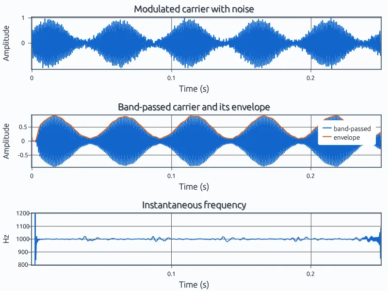

# Recover the envelope and frequency of an AM signal with a Hilbert transform

[](https://runmat.com/sandbox?example=signal-processing-am-envelope)

This example band-passes a noisy amplitude-modulated 1000 Hz carrier with a 65-tap FIR filter,
then uses the analytic signal to read back its envelope and instantaneous frequency. The message
swings from 0.10 to 0.90; the recovered envelope spans 0.08 to 0.90, and the median instantaneous
frequency is 1000 Hz.

<picture>
  <source media="(prefers-color-scheme: dark)" srcset=".artifacts/thumbnail.webp">
  
</picture>

## The problem

Many measured signals are a carrier whose amplitude or frequency carries the information: AM
radio, a bearing fault modulating a structural resonance, an ultrasonic echo, a gear mesh tone. The
quantity of interest is the slow modulation, so the analysis has to separate it from the fast
carrier.

The analytic signal does that. For a real band-limited signal x(t), the Hilbert transform gives a
90°-shifted copy, and

$$z(t) = x(t) + j\,\mathcal{H}\{x\}(t) = A(t)\,e^{j\phi(t)}$$

so the envelope is A(t) = |z(t)| and the instantaneous frequency is (1/2π) dφ/dt. This works
cleanly only when x is narrow-band around the carrier, which is why the signal is band-passed
first.

## How the example works

1. **Build the signal**: a 20 Hz message between 0.10 and 0.90 on a 1000 Hz carrier, sampled at
   8 kHz for 0.25 s, with noise:

   ```matlab
   msg = 0.5 + 0.4*sin(2*pi*20*t);
   x = msg .* sin(2*pi*1000*t) + 0.05*randn(size(t));
   ```

2. **Band-pass from 800 to 1200 Hz** as the difference of two 65-tap low-pass designs:

   ```matlab
   bLow = fir1(N-1, 1200/(Fs/2), 'low');
   bHigh = fir1(N-1, 800/(Fs/2), 'low');
   xb = filter(b, 1, x);           % b = bLow - bHigh
   ```

3. **Form the analytic signal** and read its magnitude and unwrapped phase:

   ```matlab
   z = hilbert(xb);
   env = abs(z);
   instFreq = diff(unwrap(angle(z))) * Fs / (2*pi);
   ```

4. **Trim the edges.** The statistics skip the first and last 200 samples, where the filter is
   still filling and the transform's edge effects sit.

## Results

```
Envelope: 0.08 to 0.90 (message 0.10 to 0.90)
Carrier: 1000 Hz (median instantaneous frequency)
```

The envelope's peak matches the message's 0.90. Its minimum, 0.08, sits slightly under 0.10
because the noise inside the 800–1200 Hz band adds to the carrier near the troughs. In the figure,
the envelope traces the top of the band-passed carrier, and the instantaneous frequency stays near
1000 Hz except at the record's ends.

## What to try

1. Raise the noise to `0.2*randn(size(t))` and compare the envelope's minimum with the message's
   0.10.
2. Narrow the pass band to 950–1050 Hz. The 20 Hz message puts sidebands at 980 and 1020 Hz, so
   look at whether the envelope keeps its full swing.
3. Add frequency modulation, for example `sin(2*pi*1000*t + 2*sin(2*pi*5*t))`, and watch the
   instantaneous frequency trace follow it.

## Files

- `am-envelope.m`: the script: signal, FIR band-pass, Hilbert envelope, instantaneous frequency and the three plots.
- `runmat.toml`: the project file.

## Related

- [Signal processing in RunMat](https://runmat.com/math/signal-processing)
- [Removing a tone with a notch filter](../remove-tone) and [Welch PSD against a single FFT](../welch-psd)
- Function reference: [`hilbert`](https://runmat.com/docs/reference/builtins/hilbert), [`fir1`](https://runmat.com/docs/reference/builtins/fir1), [`filter`](https://runmat.com/docs/reference/builtins/filter), [`unwrap`](https://runmat.com/docs/reference/builtins/unwrap)
- [Download RunMat](https://runmat.com/download)
