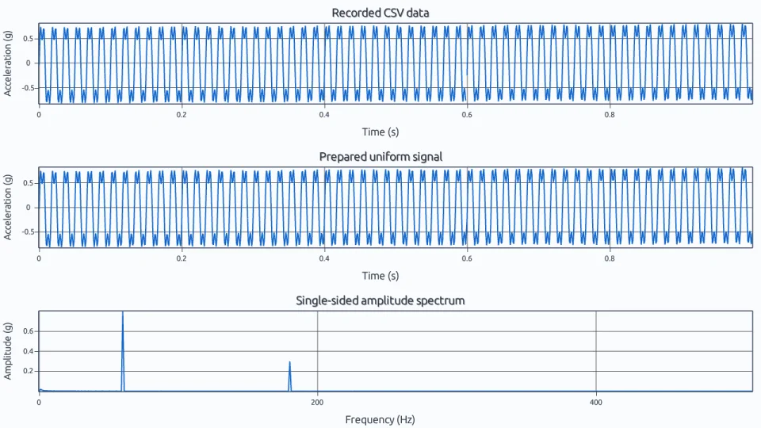

# FFT of a recorded CSV signal with gaps and missing values

[](https://runmat.com/sandbox?example=signal-processing-csv-signal-fft)

This example reads an accelerometer export from `sensor_log.csv`, checks it for timestamp gaps and
missing samples, resamples it onto a uniform 1024 Hz grid, and computes its single-sided amplitude
spectrum. The export has one timestamp gap and one missing value. The spectrum shows a 0.80 g
component at 60 Hz and a 0.30 g component at 180 Hz.

<picture>
  <source media="(prefers-color-scheme: dark)" srcset=".artifacts/thumbnail.webp">
  
</picture>

## The problem

The FFT assumes samples are evenly spaced and complete. Data loggers rarely deliver that: a
dropped sample leaves a gap in the time column, and a failed read leaves an empty cell. An FFT
taken straight from such a file smears energy across the spectrum and reports wrong amplitudes.

A short preparation step fixes both. Take the median sample interval as the nominal one, count
intervals more than 1.5 times longer as gaps, interpolate the valid samples onto a uniform grid,
and then transform. Scaling the result to single-sided amplitude makes each peak read directly in
the signal's units, here g.

## How the example works

1. **Read the export.** `sensor_log.csv` holds 1023 rows of `time_s, acceleration_g`:

   ```matlab
   data = readmatrix('sensor_log.csv', 'NumHeaderLines', 1);
   ```

2. **Inspect the timing** and count gaps and missing values:

   ```matlab
   nominal_dt = median(diff(t_recorded));
   timestamp_gap_count = sum(sample_intervals > 1.5 * nominal_dt);
   missing_value_count = sum(isnan(x_recorded));
   ```

3. **Resample onto a uniform grid** with linear interpolation through the valid samples:

   ```matlab
   t = linspace(t_recorded(1), t_recorded(end), uniform_sample_count)';
   x = interp1(t_recorded(valid_samples), x_recorded(valid_samples), t, 'linear');
   ```

4. **Compute the single-sided amplitude spectrum.** Remove the mean, divide the FFT magnitude by
   N, and double every bin except DC and Nyquist:

   ```matlab
   single_sided_amplitude = two_sided_amplitude(1:N/2+1);
   single_sided_amplitude(2:end-1) = 2 * single_sided_amplitude(2:end-1);
   ```

## Results

```
Sample rate: 1024 Hz
Gaps fixed: 1 timestamp gap, 1 missing value
```

The gap is a skipped sample after t = 0.2793 s, and the missing value is an empty cell at
t = 0.5986 s. The prepared record has 1024 samples over one second, so the bins are 1 Hz apart.
The spectrum has two lines: 0.80 g at 60 Hz and 0.30 g at 180 Hz, the third harmonic. Every other
bin stays below 0.03 g.

## What to try

1. Replace `sensor_log.csv` with your own export in the same two-column layout. The script reports
   the sample rate and the defects it repaired.
2. Change `'linear'` to `'spline'` in the `interp1` call and compare the spectra.
3. Plot `frequency_hz` against `single_sided_amplitude` with `semilogy` to see the noise floor
   under the two lines.

## Files

- `analysis.m`: the script: read, inspect, resample, FFT and the three plots.
- `sensor_log.csv`: the accelerometer export, with one skipped timestamp and one empty value.
- `runmat.toml`: the project file.

## Related

- [Signal processing in RunMat](https://runmat.com/math/signal-processing)
- [Welch PSD against a single FFT](../welch-psd) and [cleaning a sensor trace](../../data-tables/clean-sensor-trace)
- Function reference: [`readmatrix`](https://runmat.com/docs/reference/builtins/readmatrix), [`interp1`](https://runmat.com/docs/reference/builtins/interp1), [`fft`](https://runmat.com/docs/reference/builtins/fft)
- [Download RunMat](https://runmat.com/download)
