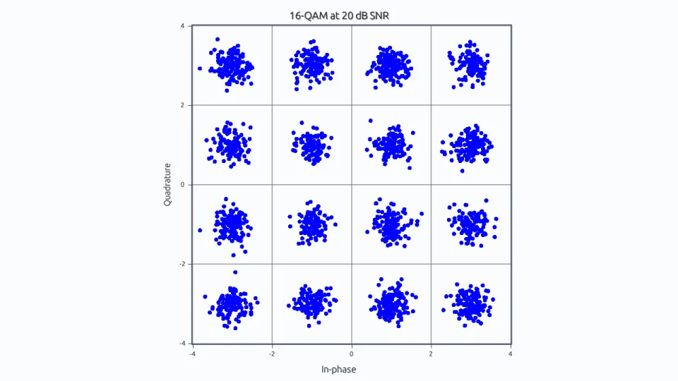

# 16-QAM constellation and error vector magnitude at 20 dB SNR

[](https://runmat.com/sandbox?example=signal-processing-qam16-constellation)

This example maps 2000 random symbols onto a 16-QAM constellation, passes them through an additive
white Gaussian noise channel at 20 dB signal-to-noise ratio, and plots what the receiver sees. The
error vector magnitude (EVM) of the received symbols is 9.9 %.

<picture>
  <source media="(prefers-color-scheme: dark)" srcset=".artifacts/thumbnail.webp">
  
</picture>

## The problem

Quadrature amplitude modulation sends bits as points on a grid in the complex plane. 16-QAM uses a
4 × 4 grid, so each symbol carries 4 bits. Noise in the channel scatters each received point
around its ideal position, and once the clouds reach the decision boundaries between points, the
receiver starts choosing the wrong symbol.

EVM is the usual measure of how far received symbols sit from their ideal points:

$$\text{EVM} = 100\,\% \times \sqrt{\frac{\overline{|r - s|^2}}{\overline{|s|^2}}}$$

For pure additive noise, EVM and SNR are tied: EVM ≈ 100 % × 10^(−SNR/20), which is 10 % at 20 dB.
Radio standards set a maximum EVM for each modulation order.

## How the example works

1. **Draw and map symbols.** `qammod` places the integers 0–15 on the square grid at ±1 and ±3:

   ```matlab
   symbols = randi([0 M-1], 2000, 1);
   tx = qammod(symbols, M);
   ```

2. **Add complex Gaussian noise** scaled to the mean symbol power and the target SNR:

   ```matlab
   noise_power = mean(abs(tx).^2) / 10^(snr_db/10);
   rx = tx + sqrt(noise_power/2) * (randn(size(tx)) + 1i*randn(size(tx)));
   ```

3. **Measure the EVM** from the error vectors `rx - tx`.

4. **Plot the received constellation** with `scatterplot`.

## Results

```
Symbols: 2000 at 20 dB SNR
Error vector magnitude: 9.9%
```

The measured 9.9 % matches the 10 % that 20 dB predicts; the gap is sampling scatter over 2000
symbols. In the figure the sixteen clouds stay well apart, each centered on its grid point, so a
nearest-point decision would recover nearly every symbol. The symbols and noise have no fixed seed,
so the EVM moves slightly between runs.

## What to try

1. Lower `snr_db` to 10. The predicted EVM is 31.6 %, and the clouds start to touch.
2. Change `M` to 64. The grid gets denser at the same SNR, so compare how much room the clouds
   have.
3. Raise the symbol count to 20000 and see how close the measured EVM settles to 10 %.

## Files

- `qam16-constellation.m`: the script: symbol mapping, noise, EVM and the constellation plot.
- `runmat.toml`: the project file.

## Related

- [Signal processing in RunMat](https://runmat.com/math/signal-processing)
- [Recovering an AM envelope](../am-envelope) and [Welch PSD against a single FFT](../welch-psd)
- Function reference: [`qammod`](https://runmat.com/docs/reference/builtins/qammod), [`scatterplot`](https://runmat.com/docs/reference/builtins/scatterplot), [`randn`](https://runmat.com/docs/reference/builtins/randn)
- [Download RunMat](https://runmat.com/download)
