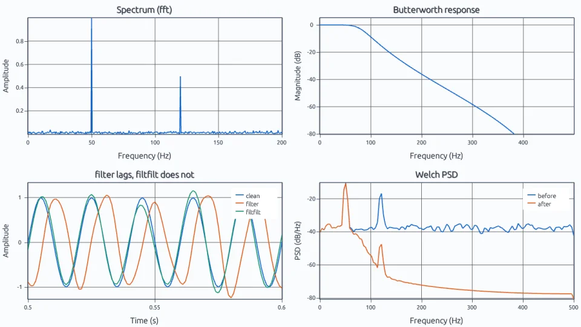

# Remove an interfering tone with a Butterworth low-pass: filter against filtfilt

[](https://runmat.com/sandbox?example=remove-tone)

This example cleans a 50 Hz signal of a 120 Hz interfering tone and broadband noise with a
fourth-order Butterworth low-pass at 80 Hz. It runs the filter two ways. The causal `filter` delays
the 50 Hz signal by 5.5 ms and leaves an RMS error of 1.068 against the clean tone; the zero-phase
`filtfilt` leaves 0.114. The Welch PSD shows the 120 Hz tone reduced by 30.6 dB.

<picture>
  <source media="(prefers-color-scheme: dark)" srcset=".artifacts/thumbnail.webp">
  
</picture>

## The problem

A measured signal often carries an unwanted component near the one you want: mains hum, a pump's
blade-pass tone, a neighboring channel. Removing it takes four steps. Find the components in the
spectrum, design a filter that passes the signal and stops the interference, apply it, and check
the result in the spectrum again.

Applying the filter has a choice of its own. A causal IIR filter, which only uses past samples,
shifts each frequency by its phase response. That is the only option in real time, but it distorts
the timing of a recorded signal. Running the filter forward and then backward (`filtfilt`) cancels
the phase, so a recorded signal comes out with no delay and the magnitude response squared.

## How the example works

1. **Build the signal** with a fixed seed: the 50 Hz tone, a 0.5-amplitude tone at 120 Hz and
   noise, 2 s at 1 kHz.

2. **Read the spectrum** as single-sided amplitude and find the largest peak:

   ```matlab
   X = abs(fft(x)) / N;
   A = 2 * X(1:N/2+1);
   ```

3. **Design the low-pass**: fourth-order Butterworth with its cutoff at 80 Hz, between the two
   tones:

   ```matlab
   [b, a] = butter(4, 80/(fs/2));
   ```

4. **Filter both ways** and measure the causal filter's delay at 50 Hz from its phase:

   ```matlab
   yc = filter(b, a, x);
   yz = filtfilt(b, a, x);
   H50 = sum(b .* exp(-1i*w*k)) / sum(a .* exp(-1i*w*k));
   ```

5. **Check with Welch PSDs** before and after, and read the attenuation in the 120 Hz bin.

## Results

```
largest peak: 50.0 Hz
filter delay at 50 Hz: 5.5 samples (5.5 ms)
RMS error vs clean tone: filter 1.068, filtfilt 0.114
120 Hz tone reduced by 30.6 dB
```

A 5.5 ms delay at 50 Hz is a phase lag of about 99°, so the causally filtered output is nearly in
quadrature with the clean tone. That is why its RMS error, 1.068, is larger than the tone's own
amplitude even though the waveform looks clean. The `filtfilt` output lines up with the clean tone,
and its 0.114 RMS error is the noise left inside the pass band. In the Welch panel, the 120 Hz
peak drops by 30.6 dB and the noise floor above the cutoff falls away steeply.

## What to try

1. Move the cutoff to 100 Hz with `butter(4, 100/(fs/2))` and compare the 120 Hz attenuation.
2. Raise the order to 8 and look at the delay that `filter` reports at 50 Hz.
3. Change the seed with `rng(1)` and see how much the RMS errors move.

## Files

- `remove-tone.m`: the script: spectrum, Butterworth design, filter against filtfilt, Welch check and the four plots.
- `runmat.toml`: the project file.

## Related

- [Signal processing in RunMat](https://runmat.com/math/signal-processing)
- [Welch PSD against a single FFT](../welch-psd) and [recovering an AM envelope](../am-envelope)
- Function reference: [`butter`](https://runmat.com/docs/reference/builtins/butter), [`filtfilt`](https://runmat.com/docs/reference/builtins/filtfilt), [`freqz`](https://runmat.com/docs/reference/builtins/freqz), [`pwelch`](https://runmat.com/docs/reference/builtins/pwelch)
- [Download RunMat](https://runmat.com/download)
