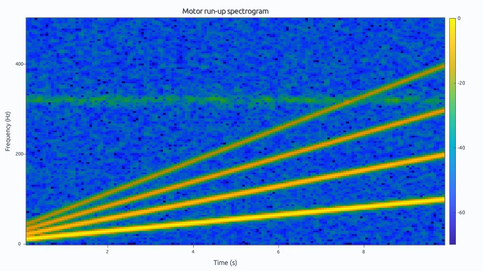

# Spectrogram of a motor run-up: shaft orders and a fixed resonance

[](https://runmat.com/sandbox?example=signal-processing-run-up-spectrogram)

This example simulates 10 s of vibration from a motor ramping from 600 to 6000 rpm and draws its
spectrogram from 0 to 500 Hz. The first four shaft orders rise as straight lines, from 10–40 Hz at
the start to 100–400 Hz at the end. A structural resonance at 320 Hz stays at the same frequency
throughout.

<picture>
  <source media="(prefers-color-scheme: dark)" srcset=".artifacts/thumbnail.webp">
  
</picture>

## The problem

Rotating machines are tested by sweeping their speed and recording vibration. Two kinds of
component show up. Shaft orders are tied to speed: order n sits at n × rpm / 60 Hz, so it moves as
the machine speeds up. Structural resonances are tied to the structure, so they stay at fixed
frequencies whatever the speed.

A spectrogram separates them at a glance. It cuts the record into short overlapping windows,
takes the spectrum of each, and plots power against time and frequency. Orders become sloped
lines and resonances become horizontal ones. Where an order crosses a resonance, the machine runs
at a critical speed.

## How the example works

1. **Ramp the speed** linearly and integrate it to a shaft angle:

   ```matlab
   rpm = 600 + (6000 - 600) * t / t(end);
   phase = 2*pi*cumsum(rpm/60)/fs;
   x = sin(phase) + 0.6*sin(2*phase) + 0.35*sin(3*phase) + 0.2*sin(4*phase);
   ```

2. **Add a resonance** by passing noise through a two-pole filter centered at 320 Hz, with pole
   radius 0.995:

   ```matlab
   ring = filter(1, [1 -2*r*cos(w0) r^2], randn(size(t)));
   ```

3. **Compute the spectrogram** with 512-sample Hann windows, 384 samples of overlap and a 512-point
   FFT, at 2 kHz:

   ```matlab
   [s, f, tt, ps] = spectrogram(x, hann(512), 384, 512, fs);
   ```

4. **Plot power in dB** relative to the peak, over a 70 dB range, from 0 to 500 Hz:

   ```matlab
   imagesc([tt(1) tt(end)], [f(1) max(f(keep))], power_db(keep, :));
   axis xy;
   clim([-70 0]);
   ```

## Results

The figure shows four bright sloped lines. Order 1 runs from 10 to 100 Hz, order 2 from 20 to
200 Hz, order 3 from 30 to 300 Hz and order 4 from 40 to 400 Hz. The 320 Hz resonance shows as a
fainter horizontal band across the whole record. Order 4 crosses it at a shaft speed of 4800 rpm,
7.8 s into the run; that is the critical speed in this record. Each window is 512 samples, so each
column of the spectrogram covers 0.256 s and each row is 3.9 Hz.

## What to try

1. Move the resonance to 150 Hz with `w0 = 2*pi*150/fs`. Orders 2, 3 and 4 now cross it, at 4500,
   3000 and 2250 rpm.
2. Shorten the window to `hann(128)` with 96 samples of overlap and compare how sharp the order
   lines and the resonance band look.
3. Plot the slice `power_db(:, end)` against `f` to read the order levels at full speed.

## Files

- `run-up-spectrogram.m`: the script: speed ramp, shaft orders, resonance, spectrogram and the plot.
- `runmat.toml`: the project file.

## Related

- [Signal processing in RunMat](https://runmat.com/math/signal-processing)
- [Spectrogram of a sweep](../spectrogram-check) and [Welch PSD against a single FFT](../welch-psd)
- Function reference: [`spectrogram`](https://runmat.com/docs/reference/builtins/spectrogram), [`hann`](https://runmat.com/docs/reference/builtins/hann), [`imagesc`](https://runmat.com/docs/reference/builtins/imagesc)
- [Download RunMat](https://runmat.com/download)
