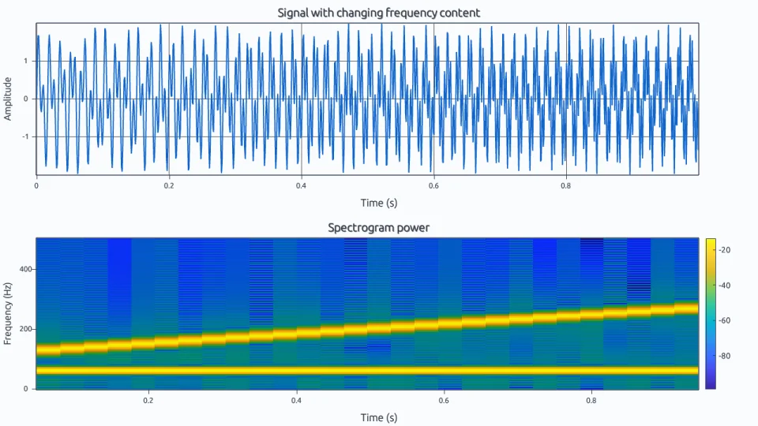

# Spectrogram of a frequency sweep and a steady tone

[](https://runmat.com/sandbox?example=signal-processing-spectrogram-check)

This example computes the spectrogram of a one-second signal that holds a steady 60 Hz tone and a
linear sweep from 120 to 280 Hz. The spectrogram reads the steady tone at 58.6 Hz, the nearest
3.9 Hz bin, and tracks the sweep from 129 Hz at 0.06 s to 270 Hz at 0.93 s.

<picture>
  <source media="(prefers-color-scheme: dark)" srcset=".artifacts/thumbnail.webp">
  
</picture>

## The problem

A single FFT reports which frequencies a record contains, but not when. For a signal whose content
changes, such as a chirp, a machine changing speed, or a transient, the time trace and the FFT
both hide the picture. The spectrogram, a short-time Fourier transform, takes the spectrum of
short overlapping windows and plots power against time and frequency.

The window length sets the trade-off. A window of L samples at sample rate Fs resolves frequency to
about Fs/L and time to about L/Fs. This example uses 128-sample windows at 1 kHz, about 128 ms
long, zero-padded to 256 points, so the bins are 1000/256 = 3.9 Hz apart.

The sweep is written as sin(2π(120 + 80t)t). Its instantaneous frequency is the derivative of the
phase over 2π:

$$f(t) = \frac{d}{dt}\big[(120 + 80t)\,t\big] = 120 + 160t \ \text{Hz}$$

so it climbs from 120 Hz at t = 0 to 280 Hz at t = 1 s.

## How the example works

1. **Build the signal**, a steady tone plus the sweep:

   ```matlab
   x = sin(2*pi*60*t) + sin(2*pi*(120 + 80*t).*t);
   ```

2. **Compute the spectrogram** with 128-sample Hamming windows, 96 samples of overlap and a
   256-point FFT:

   ```matlab
   [s, f, tt, ps] = spectrogram(x, hamming(128), 96, 256, Fs);
   power_db = 10 * log10(ps + 1e-12);
   ```

3. **Track the components.** In the first and last frames, the script takes the strongest bin
   above 90 Hz as the sweep and the strongest bin below it as the steady tone.

4. **Plot** the time trace above the spectrogram, with power in dB.

## Results

```
Steady tone: 58.6 Hz (bin width 3.9 Hz)
Sweep: 129 Hz at 0.06 s, 270 Hz at 0.93 s
```

The formula predicts the sweep at 129.6 Hz at 0.06 s and 268.8 Hz at 0.93 s; the spectrogram's
readings fall within one bin of both. The steady tone reads 58.6 Hz because bins sit at multiples
of 3.9 Hz and 58.6 Hz is the closest one to 60 Hz. In the figure, the tone is a horizontal band and
the sweep a straight line rising across the record.

## What to try

1. Change the window to `hamming(256)` with 192 samples of overlap and a 512-point FFT. The bins
   shrink to 1.95 Hz, and each frame covers twice as long.
2. Make the sweep quadratic with `sin(2*pi*(120 + 80*t.^2).*t)` and watch the line curve.
3. Add `0.5*randn(size(t))` and see how far the sweep stays visible above the noise.

## Files

- `spectrogram-check.m`: the script: signal, spectrogram, component tracking and the two plots.
- `runmat.toml`: the project file.

## Related

- [Signal processing in RunMat](https://runmat.com/math/signal-processing)
- [Motor run-up spectrogram](../run-up-spectrogram) and [Welch PSD against a single FFT](../welch-psd)
- Function reference: [`spectrogram`](https://runmat.com/docs/reference/builtins/spectrogram), [`hamming`](https://runmat.com/docs/reference/builtins/hamming), [`imagesc`](https://runmat.com/docs/reference/builtins/imagesc)
- [Download RunMat](https://runmat.com/download)
