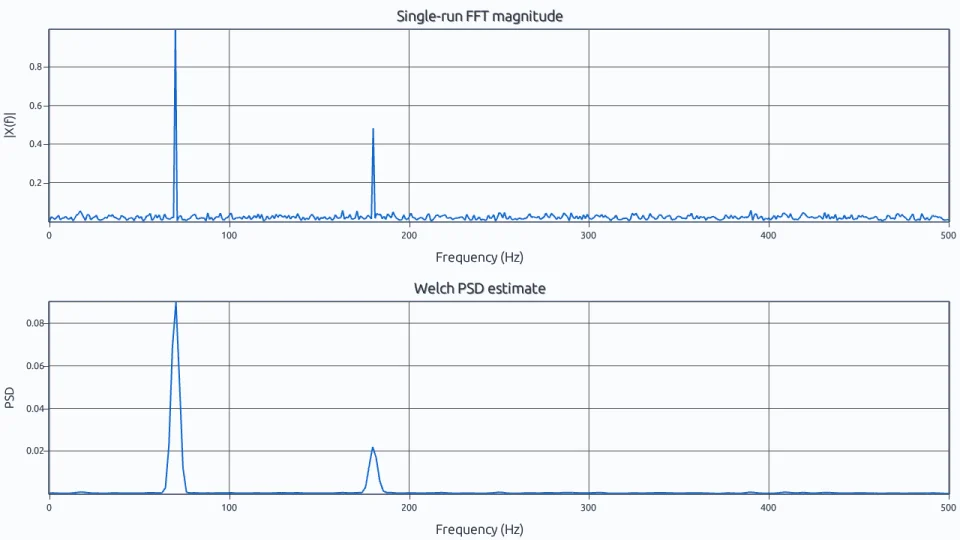

# Welch PSD against a single FFT: reading tones in a noisy signal

[](https://runmat.com/sandbox?example=signal-processing-welch-psd)

This example takes one second of a 1 kHz-sampled signal holding a 70 Hz tone, a 180 Hz tone and
white noise, and estimates its spectrum two ways: one FFT of the whole record, and Welch's method
with 256-sample Hamming segments. Both find the tones at 70 Hz and 180 Hz. In the quiet band from
250 to 450 Hz, the single FFT's noise floor peaks at 9.0 times its median, and Welch's at 2.3
times.

<picture>
  <source media="(prefers-color-scheme: dark)" srcset=".artifacts/thumbnail.webp">
  
</picture>

## The problem

A single FFT of a noisy record gives a spectrum whose noise floor is as ragged as the noise itself.
Each frequency bin is one random sample, and taking a longer record narrows the bins without
smoothing them. A spike in the floor can pass for a real tone, and a weak tone can hide in the
floor.

Welch's method trades frequency resolution for a steadier estimate. It splits the record into
overlapping segments, windows each one, and averages their periodograms. With K independent
segments, the variance of each bin falls roughly as 1/K. The cost is wider bins: a segment of L
samples resolves Fs/L, here 1000/256 ≈ 3.9 Hz.

## How the example works

1. **Build the test signal**, two tones plus noise with standard deviation 0.35:

   ```matlab
   Fs = 1000;
   t = 0:1/Fs:1-1/Fs;
   x = sin(2*pi*70*t) + 0.5*sin(2*pi*180*t) + 0.35*randn(size(t));
   ```

2. **Take one FFT** of the mean-removed record and scale it to single-sided amplitude:

   ```matlab
   Y = fft(x - sum(x) / N);
   pFft = abs(Y(1:N/2+1)) * 2/N;
   ```

3. **Estimate the PSD with Welch's method**: 256-sample Hamming windows, 128 samples of overlap and
   a 512-point FFT per segment:

   ```matlab
   [pxx, fWelch] = pwelch(x, hamming(256), 128, 512, Fs);
   ```

4. **Find the two tones.** The script takes the largest PSD peak, masks 20 Hz on either side of it,
   and takes the next largest.

5. **Measure the noise floor's spread** as the ratio of its maximum to its median in 250–450 Hz,
   where there is no tone, for each estimate.

## Results

```
Tones found at 70 Hz and 180 Hz
Noise floor max/median: single FFT 9.0, Welch 2.3
```

Both estimates locate the tones. The difference is in the floor: the single FFT has bins up to 9.0
times the median noise level, while Welch keeps them within 2.3 times. In the figure, the single
FFT shows two needle-thin lines over a grassy floor. The Welch PSD shows wider peaks over a nearly
flat floor. The noise is random and has no fixed seed, so these ratios change a little from run
to run.

## What to try

1. Use `hamming(64)` with 32 samples of overlap. Each bin is now 1000/64 ≈ 15.6 Hz wide, and more
   segments go into the average. Compare the peak widths and the floor ratio.
2. Add a weak third tone, such as `0.05*sin(2*pi*320*t)`, inside the quiet band, and look for it
   in each estimate.
3. Raise the noise to `1.0*randn(size(t))` and see which estimate still separates the 180 Hz
   tone from the floor.

## Files

- `welch-psd.m`: the script: test signal, single FFT, Welch PSD, tone search and the two plots.
- `runmat.toml`: the project file.

## Related

- [Signal processing in RunMat](https://runmat.com/math/signal-processing)
- [Spectrum of a recorded CSV](../csv-signal-fft) and [checking a spectrogram](../spectrogram-check)
- Function reference: [`pwelch`](https://runmat.com/docs/reference/builtins/pwelch), [`fft`](https://runmat.com/docs/reference/builtins/fft), [`hamming`](https://runmat.com/docs/reference/builtins/hamming)
- [Download RunMat](https://runmat.com/download)
