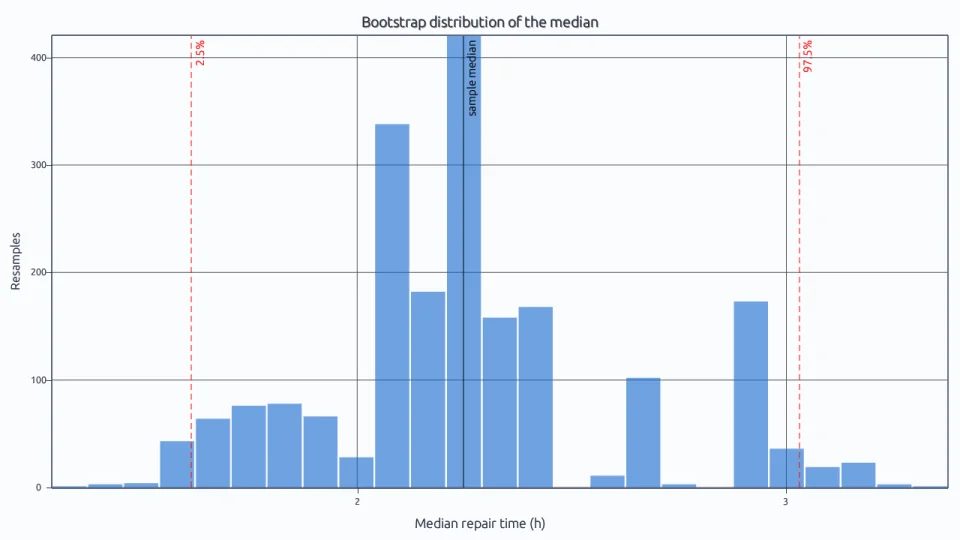

# Bootstrap confidence interval for a median repair time

[](https://runmat.com/sandbox?example=statistics-bootstrap-median)

This example puts a 95 % confidence interval on the median of 60 skewed repair times by
resampling the data 2000 times. The sample median is 2.25 h, and the percentile bootstrap gives an
interval of 1.61 to 3.03 h. The sample mean, 3.29 h, sits well above the median because the data
are skewed, with skewness 2.23.

<picture>
  <source media="(prefers-color-scheme: dark)" srcset=".artifacts/thumbnail.webp">
  
</picture>

## The problem

Repair times, failure times, queue waits and response times are skewed: most values are short and
a few are long. For such data the median describes a typical case better than the mean. The median
has no simple standard-error formula, though, so the textbook mean ± t·s/√n interval does not
apply to it.

The bootstrap gets the interval from the data. Draw n values from the sample with replacement,
compute the median of that resample, and repeat many times. The spread of those medians estimates
how much the median would vary between samples. The percentile interval takes the 2.5th and 97.5th
percentiles of the bootstrap medians as the 95 % bounds.

## How the example works

1. **Draw the sample**: 60 repair times from an exponential distribution with mean 3.5 h, with a
   fixed seed:

   ```matlab
   rng(4);
   repair = exprnd(3.5, 60, 1);
   ```

2. **Resample 2000 times** and take the median of each resample:

   ```matlab
   medians = bootstrp(2000, @median, repair);
   ```

3. **Read the percentile interval**:

   ```matlab
   ci = prctile(medians, [2.5 97.5]);
   ```

4. **Plot the bootstrap distribution** with the interval bounds and the sample median marked by
   `xline`.

## Results

```
Median 2.25 h; 95% bootstrap interval 1.61 to 3.03 h
Mean 3.29 h sits above the median: the sample is skewed (skewness 2.23)
```

The interval is asymmetric: it reaches 0.64 h below the median and 0.78 h above it, following the
long right tail of the data. The histogram of bootstrap medians is lumpy, with tall bars near the
sample median and gaps elsewhere. That is expected: the median of 60 values is the average of the
30th and 31st ordered values, so the bootstrap medians can only take a limited set of values. For
the exponential distribution the sample came from, the true median is 3.5 × ln 2 = 2.43 h, inside
the interval.

## What to try

1. Bootstrap the mean instead with `bootstrp(2000, @mean, repair)` and compare its interval with
   the median's.
2. Raise the sample to 240 repair times and look at how much the interval narrows.
3. Change the seed with `rng(5)` and check whether 2.43 h still falls inside the interval.

## Files

- `bootstrap-median.m`: the script: sample, bootstrap, percentile interval and the histogram.
- `runmat.toml`: the project file.

## Related

- [Statistics in RunMat](https://runmat.com/math/statistics)
- [Fitting a distribution](../fit-distribution) and [comparing two batches](../two-batches)
- Function reference: [`bootstrp`](https://runmat.com/docs/reference/builtins/bootstrp), [`prctile`](https://runmat.com/docs/reference/builtins/prctile), [`exprnd`](https://runmat.com/docs/reference/builtins/exprnd)
- [Download RunMat](https://runmat.com/download)
