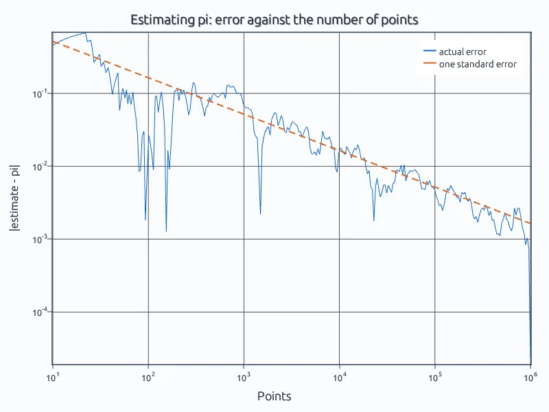

# Estimate pi by Monte Carlo and watch the error fall as one over root N

[](https://runmat.com/sandbox?example=statistics-estimate-pi)

This example estimates π from one million random points in a unit square, counting the fraction
that falls inside the quarter circle. After 1,000,000 points the estimate is 3.13980, an error of
0.00179 against a standard error of 0.00164. A log-log plot of the error at every sample size
follows the 1/√N line.

<picture>
  <source media="(prefers-color-scheme: dark)" srcset=".artifacts/thumbnail.webp">
  
</picture>

## The problem

Monte Carlo methods estimate a quantity by averaging random samples. They are used for integrals
in many dimensions, reliability and tolerance studies, and option pricing. Every such study has
the same convergence rule, and estimating π shows it with the least machinery.

A point drawn uniformly in the unit square lands inside the quarter circle x² + y² ≤ 1 with
probability π/4. The fraction p̂ inside, times 4, estimates π. Each point is a Bernoulli trial, so
the standard error of the estimate is

$$\sigma_{\hat\pi} = 4\sqrt{\frac{(\pi/4)(1 - \pi/4)}{N}} \approx \frac{1.64}{\sqrt{N}}$$

The error shrinks as 1/√N whatever the problem's dimension: ten times the points buys √10 ≈ 3.16
times the accuracy.

## How the example works

1. **Draw the points** with a fixed seed and flag those inside the quarter circle:

   ```matlab
   rng(2);
   xy = rand(N, 2);
   inside = sum(xy.^2, 2) <= 1;
   ```

2. **Form the running estimate** at every N with one cumulative sum:

   ```matlab
   estimate = 4*cumsum(inside) ./ (1:N)';
   ```

3. **Sample 300 log-spaced sizes** from 10 to 10⁶ and compute the actual error and the standard
   error at each:

   ```matlab
   k = unique(round(logspace(1, 6, 300)))';
   spread = 4*sqrt((pi/4)*(1 - pi/4) ./ k);
   ```

4. **Plot both on log-log axes**, where 1/√N is a straight line with slope −1/2.

## Results

```
pi is about 3.13980 after 1000000 points (error 0.00179, standard error 0.00164)
Ten times the points buys about 3.16 times the accuracy
```

The final error, 0.00179, is 1.09 standard errors, an ordinary outcome for one random run. In the
figure the actual error wanders around the dashed standard-error line over five decades of N. The
deep dips are sizes where the running estimate happens to cross π.

## What to try

1. Change the seed with `rng(3)` and compare the final error with the 0.00164 standard error.
2. Use the unit ball instead: draw `rand(N, 3)` and count points with `sum(xyz.^2, 2) <= 1`. The
   fraction inside is π/6, so 6 times it estimates π, with a standard error of about 3.00/√N.
3. Cut `N` to `1e4`. The standard error at that size is 0.0164, ten times larger.

## Files

- `estimate-pi.m`: the script: random points, running estimate, error and standard error, and the log-log plot.
- `runmat.toml`: the project file.

## Related

- [Statistics in RunMat](https://runmat.com/math/statistics)
- [Monte Carlo study](../monte-carlo) and [tolerance stack-up](../tolerance-stack-up)
- Function reference: [`rand`](https://runmat.com/docs/reference/builtins/rand), [`cumsum`](https://runmat.com/docs/reference/builtins/cumsum), [`loglog`](https://runmat.com/docs/reference/builtins/loglog)
- [Download RunMat](https://runmat.com/download)
