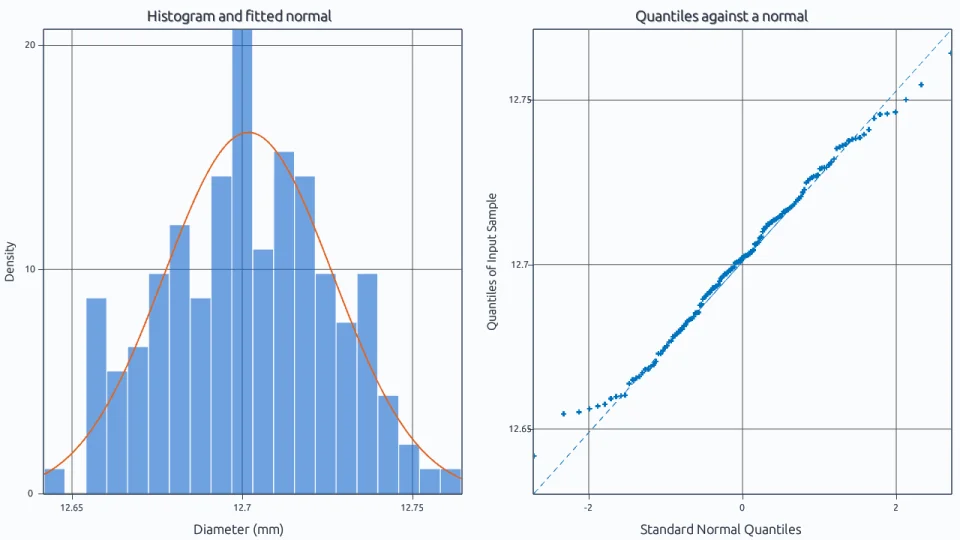

# Fit a normal distribution to measured diameters and check the fit

[](https://runmat.com/sandbox?example=statistics-fit-distribution)

This example fits a normal distribution to 150 measured shaft diameters, checks the fit with a
histogram, a QQ plot and a Kolmogorov-Smirnov test, and uses the fitted model to predict the
fraction outside a 12.70 ± 0.06 mm tolerance. The fit gives a mean of 12.7018 mm and a standard
deviation of 0.0248 mm. The KS test returns p = 0.980, and the model predicts 1.564 % of parts out
of tolerance.

<picture>
  <source media="(prefers-color-scheme: dark)" srcset=".artifacts/thumbnail.webp">
  
</picture>

## The problem

Process capability and yield predictions start from a distribution fitted to measurements. The
fitted model answers questions the sample alone cannot, such as how many parts in a million fall
outside a tolerance that no measured part has crossed yet. The answer is only as good as the fit,
so the fit needs checking before it is used.

Two checks are standard. A QQ plot draws the sorted data against the quantiles a normal
distribution would give; points on a straight line mean the shape matches, and curvature at the
ends shows heavy or light tails. The Kolmogorov-Smirnov test measures the largest gap between the
sample's cumulative distribution and the model's. A high p-value means the data give no evidence
against the model.

## How the example works

1. **Draw the measurements**: 150 diameters around 12.70 mm with 0.025 mm spread, with a fixed
   seed.

2. **Fit the normal distribution** by maximum likelihood:

   ```matlab
   pd = fitdist(d, 'Normal');
   ```

3. **Test the fit.** Standardize with the fitted parameters and compare against the standard
   normal:

   ```matlab
   [h, p] = kstest((d - pd.mu)/pd.sigma);
   ```

4. **Predict the out-of-tolerance fraction** from the fitted cumulative distribution:

   ```matlab
   100*(1 - (cdf(pd, 12.76) - cdf(pd, 12.64)))
   ```

5. **Plot** the histogram, scaled as a density, with the fitted curve, and the QQ plot beside it.

## Results

```
Fitted mean 12.7018 mm, standard deviation 0.0248 mm
Kolmogorov-Smirnov p = 0.980 (h = 0)
Expected out of 12.70 +/- 0.06 mm: 1.564%
```

The test does not reject normality (h = 0), and the QQ points lie along the reference line with no
bend at either end. The tolerance limits sit about 2.3 and 2.5 standard deviations from the fitted
mean, which puts 1.564 % of production outside them. Because the KS test here uses parameters
estimated from the same data, its p-value is somewhat optimistic; the QQ plot is the more direct
check of the tails.

## What to try

1. Tighten the process to `0.020*randn(150, 1)`. With the same seed the fitted standard deviation
   becomes about 0.0198 mm and the predicted out-of-tolerance fraction about 0.26 %.
2. Replace the data with a skewed sample, such as `12.65 + 0.025*exprnd(1, 150, 1)`, and look at
   how the QQ plot bends.
3. Fit `'Lognormal'` or `'Weibull'` with `fitdist` and compare the predicted fractions.

## Files

- `fit-distribution.m`: the script: fit, KS test, tolerance prediction, histogram and QQ plot.
- `runmat.toml`: the project file.

## Related

- [Statistics in RunMat](https://runmat.com/math/statistics)
- [Kernel density estimate](../kernel-density) and [tolerance stack-up](../tolerance-stack-up)
- Function reference: [`fitdist`](https://runmat.com/docs/reference/builtins/fitdist), [`kstest`](https://runmat.com/docs/reference/builtins/kstest), [`qqplot`](https://runmat.com/docs/reference/builtins/qqplot)
- [Download RunMat](https://runmat.com/download)
