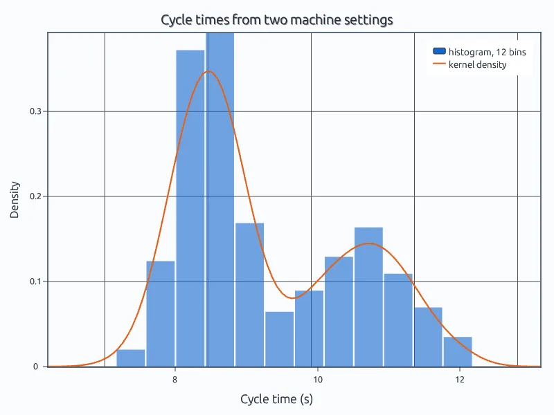

# Kernel density estimate: find two populations hidden in one sample

[](https://runmat.com/sandbox?example=kernel-density)

This example takes 350 cycle times from a machine that ran at two settings and compares a
12-bin histogram with a kernel density estimate. The density curve shows two peaks, one for each
setting, with the densest point at 8.05 s.

<picture>
  <source media="(prefers-color-scheme: dark)" srcset=".artifacts/thumbnail.webp">
  
</picture>

## The problem

Production data often mixes populations: two machine settings, two shifts, two suppliers. A
summary that assumes one population, such as a mean and standard deviation, describes neither of
them. The first step is to see whether the data have more than one peak.

A histogram can show this, but its shape depends on the bin count and bin edges. A kernel density
estimate places a smooth bump, usually a Gaussian, on every data point and adds them:

$$\hat f(x) = \frac{1}{n h} \sum_{i=1}^{n} K\!\left(\frac{x - x_i}{h}\right)$$

The bandwidth h plays the role of the bin width. `ksdensity` picks it from the data with a
normal-reference rule, which gives a smooth curve without edge artifacts.

## How the example works

1. **Build the mixed sample**: 220 cycles around 8 s and 130 around 11 s, with a fixed seed:

   ```matlab
   rng(10);
   cycle = [8 + 0.6*randn(220, 1); 11 + 0.9*randn(130, 1)];
   ```

2. **Estimate the density** and find its maximum:

   ```matlab
   [f, xi] = ksdensity(cycle);
   [~, k] = max(f);
   ```

3. **Overlay the curve on the histogram**, with the histogram normalized as a density so both share
   one axis:

   ```matlab
   histogram(cycle, 12, 'Normalization', 'pdf');
   plot(xi, f, 'LineWidth', 2.2);
   ```

## Results

```
350 cycles; densest at 8.05 s
```

The density curve has a tall peak for the 220 faster cycles and a lower, wider one for the 130
slower cycles, with a clear dip between them. The densest point, 8.05 s, matches the faster
setting's 8 s center. The 12-bin histogram shows the same two groups, but its bar heights jump
with the bin edges, and a different bin count can merge or split them.

## What to try

1. Change the histogram to `histogram(cycle, 6, ...)` and see whether the two groups are still
   visible.
2. Narrow the bandwidth with `ksdensity(cycle, 'Bandwidth', 0.15)` and compare how many peaks the
   curve shows.
3. Move the second setting to `9 + 0.9*randn(130, 1)` and look at whether the curve still has two
   peaks.

## Files

- `kernel-density.m`: the script: mixed sample, kernel density, histogram and the overlay plot.
- `runmat.toml`: the project file.

## Related

- [Statistics in RunMat](https://runmat.com/math/statistics)
- [Fitting a distribution](../fit-distribution) and [comparing three batches with ANOVA](../three-batches-anova)
- Function reference: [`ksdensity`](https://runmat.com/docs/reference/builtins/ksdensity), [`histogram`](https://runmat.com/docs/reference/builtins/histogram)
- [Download RunMat](https://runmat.com/download)
