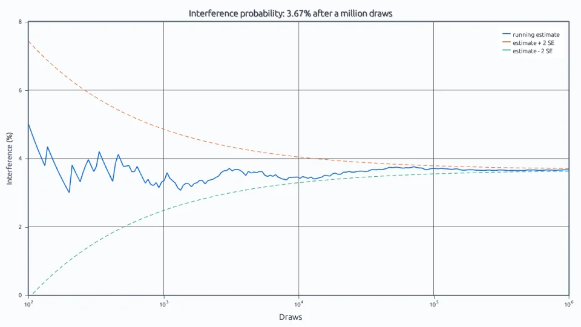

# Monte Carlo tolerance stack-up: probability of shaft-bore interference

[](https://runmat.com/sandbox?example=statistics-monte-carlo)

This example estimates how often a shaft interferes with its bore once both diameters vary and the
shaft grows with temperature. It draws one million assemblies and finds an interference probability
of 3.67 %. The plot shows the running estimate settling inside a two-standard-error band that
narrows as 1/√n.

<picture>
  <source media="(prefers-color-scheme: dark)" srcset=".artifacts/thumbnail.webp">
  
</picture>

## The problem

A clearance fit works only if the bore stays larger than the shaft across every part combination
and operating condition. Worst-case stacking, adding every tolerance at its limit, often rejects
designs that would work in practice. A statistical stack-up asks a different question: with each
dimension drawn from its own distribution, what fraction of assemblies fails?

Monte Carlo answers by sampling. Draw each dimension, compute the clearance for each draw, and count
failures. The estimate p̂ of a probability p from n draws has standard error √(p(1 − p)/n), so the
draw count sets the precision directly.

The inputs here are a 25.000 mm shaft with 0.010 mm standard deviation, a 25.030 mm bore with
0.012 mm, and thermal growth of the shaft of 0.002 mm with 0.0006 mm.

## How the example works

1. **Draw one million assemblies** with a fixed seed:

   ```matlab
   shaft = 25.000 + 0.010*randn(N, 1);
   bore = 25.030 + 0.012*randn(N, 1);
   growth = 0.002 + 0.0006*randn(N, 1);
   clearance = bore - shaft - growth;
   ```

2. **Estimate the probability** of negative clearance, and the running estimate at every n:

   ```matlab
   p = mean(clearance < 0);
   running = cumsum(clearance < 0) ./ n;
   ```

3. **Compute the ±2 standard-error band** at 200 log-spaced draw counts from 100 to 10⁶:

   ```matlab
   band = 2*sqrt(p*(1 - p) ./ k);
   ```

4. **Plot** the running estimate and the band on a log draw axis with `semilogx`.

## Results

After a million draws the interference probability is 3.67 %. At that count, two standard errors
are ±0.04 percentage points; at 100 draws they are ±3.8 points. In the figure, the running estimate
jumps between 3 % and 5 % over the first few hundred draws and then stays inside the band as it
closes in.

Because all three inputs are normal, this case also has a closed form. The clearance is normal with
mean 0.028 mm and standard deviation √(0.010² + 0.012² + 0.0006²) = 0.01563 mm, so interference
happens at 1.79 standard deviations below the mean, with probability 3.66 %. The Monte Carlo
result agrees within its standard error. Sampling earns its place once a distribution is skewed or
truncated, or the clearance is a nonlinear function of the dimensions.

## What to try

1. Tighten the bore to `0.008*randn(N, 1)`. The closed form gives 1.45 %.
2. Move the bore's nominal to 25.035 mm. The closed form gives 1.74 %.
3. Cut `N` to `1e4` and compare the final estimate with the band's width at that count.

## Files

- `monte-carlo.m`: the script: random assemblies, interference probability, standard-error band and the plot.
- `runmat.toml`: the project file.

## Related

- [Statistics in RunMat](https://runmat.com/math/statistics)
- [Tolerance stack-up](../tolerance-stack-up) and [estimating pi by Monte Carlo](../estimate-pi)
- Function reference: [`randn`](https://runmat.com/docs/reference/builtins/randn), [`cumsum`](https://runmat.com/docs/reference/builtins/cumsum), [`semilogx`](https://runmat.com/docs/reference/builtins/semilogx)
- [Download RunMat](https://runmat.com/download)
