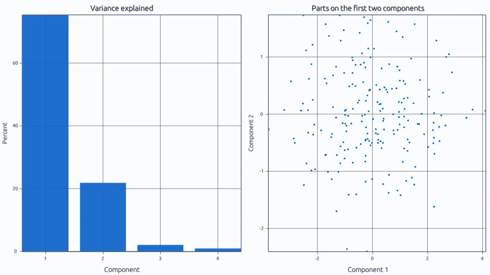

# Principal component analysis of correlated gauge readings

[](https://runmat.com/sandbox?example=statistics-principal-components)

This example runs principal component analysis on four gauge readings taken from each of 200
parts. The first component explains 75.2 % of the variance and the second 21.8 %, so two directions
carry 97.0 % of the variation. The first component loads on gauges 1–3 (0.64, 0.58, 0.50) and
barely on gauge 4 (0.09).

<picture>
  <source media="(prefers-color-scheme: dark)" srcset=".artifacts/thumbnail.webp">
  
</picture>

## The problem

Inspection stations often measure several dimensions on each part, and those measurements move
together because a few underlying causes drive them: a part's overall size, a warp from cooling, a
fixture offset. Charting each gauge separately repeats the same signal several times and hides
which causes are at work.

Principal component analysis rotates the data onto new axes ordered by variance. The first
component is the direction along which the parts vary most, the second is the largest remaining
direction at right angles to it, and so on. The variance explained by each component shows how
many independent causes the data hold. The loadings, the weights of each gauge in a component, show
which gauges each cause moves.

## How the example works

1. **Build the readings** from two hidden causes, size and warp, plus gauge noise:

   ```matlab
   X = [sz + 0.1*randn(n, 1), 0.9*sz + 0.2*randn(n, 1), ...
        0.7*sz + 0.5*warp + 0.2*randn(n, 1), 0.6*warp + 0.3*randn(n, 1)];
   ```

   Gauges 1 and 2 follow size, gauge 4 follows warp, and gauge 3 sees both.

2. **Run PCA**:

   ```matlab
   [coeff, score, ~, ~, explained] = pca(X);
   ```

   `coeff` holds the loadings, `score` each part's coordinates on the new axes, and `explained` the
   percent of variance per component.

3. **Plot** the variance explained as a bar chart, and the parts on the first two components as a
   scatter.

## Results

```
Variance explained: 75.2 21.8 2.0 0.9  %
First component loadings: 0.64 0.58 0.50 0.09
```

Two components carry 97.0 % of the variance, matching the two causes built into the data. The
remaining 2.9 % is gauge noise. The first component's loadings pick out size: gauges 1–3 weigh in
and gauge 4 hardly at all. In the scatter, the parts form one round cloud with no clusters, so no
subgroup of parts behaves differently.

## What to try

1. Print `coeff(:, 2)` and check that the second component loads on gauges 3 and 4, the two that
   see warp.
2. Remove warp from gauge 3 by replacing its column with `0.7*sz + 0.2*randn(n, 1)`, and compare
   the variance explained.
3. Add a fifth gauge that reads pure noise, `randn(n, 1)`, and look at where its variance lands.

## Files

- `principal-components.m`: the script: gauge readings, PCA, the variance bar chart and the score scatter.
- `runmat.toml`: the project file.

## Related

- [Statistics in RunMat](https://runmat.com/math/statistics)
- [Regression with diagnostics](../regression-diagnostics) and [low-rank approximation with the SVD](../../linear-algebra/low-rank-svd)
- Function reference: [`pca`](https://runmat.com/docs/reference/builtins/pca), [`bar`](https://runmat.com/docs/reference/builtins/bar), [`scatter`](https://runmat.com/docs/reference/builtins/scatter)
- [Download RunMat](https://runmat.com/download)
