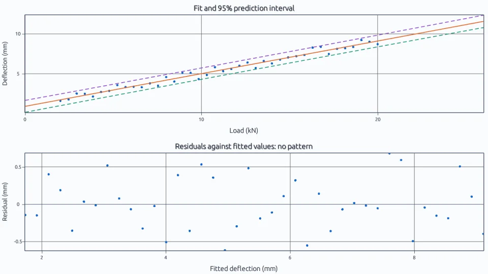

# Linear regression with a prediction interval and residual check

[](https://runmat.com/sandbox?example=statistics-regression-diagnostics)

This example fits a straight line to 40 load-deflection measurements, predicts the deflection at a
load beyond the tested range, and checks the residuals. The fit is deflection = 0.410 × load +
0.912 mm with R² = 0.9767. At 25 kN it predicts 11.16 mm, with a 95 % prediction interval of 10.39
to 11.93 mm.

<picture>
  <source media="(prefers-color-scheme: dark)" srcset=".artifacts/thumbnail.webp">
  
</picture>

## The problem

Calibrations and stiffness tests fit a line to measured pairs and then use the line to predict.
Three questions decide whether the prediction can be trusted. How well does the line fit? How far
might a single new measurement fall from it? Is a straight line the right model at all?

R² answers the first. The prediction interval answers the second: it covers the uncertainty in the
fitted line and the scatter of a single new observation, so it is wider than the confidence
interval on the mean response and widens away from the center of the data. The residual plot
answers the third. Residuals against fitted values should form a structureless band around zero. A
curve means the model is missing a term, and a funnel means the scatter changes with the level.

## How the example works

1. **Generate the test data**: 40 loads from 2 to 20 kN, deflection 0.42 mm/kN plus a 0.8 mm
   offset, and 0.35 mm of measurement noise, with a fixed seed.

2. **Fit the linear model**:

   ```matlab
   m = fitlm(load_kN, deflection);
   b = m.Coefficients.Estimate;
   ```

3. **Predict at 25 kN** with an interval for a single new observation:

   ```matlab
   [yq, yci] = predict(m, 25, 'Prediction', 'observation');
   ```

4. **Draw the band** from 0 to 26 kN, and plot residuals against fitted values:

   ```matlab
   [yf, band] = predict(m, xq, 'Prediction', 'observation');
   plot(m.Fitted, m.Residuals.Raw, 'o');
   ```

## Results

```
deflection = 0.410 * load + 0.912 mm, R^2 = 0.9767
At 25 kN: 11.16 mm, 95% prediction interval 10.39 to 11.93 mm
```

The fitted slope, 0.410 mm/kN, and offset, 0.912 mm, are close to the 0.42 and 0.8 used to make
the data; the difference is the measurement noise. The prediction interval at 25 kN is ±0.77 mm
wide. The residuals scatter evenly around zero across the whole fitted range, with no curve or
funnel, so a straight line is an adequate model. The 25 kN prediction lies beyond
the tested range of 2 to 20 kN, and the interval covers only the scatter of the data: it assumes
the part stays linear past 20 kN.

## What to try

1. Add curvature with `+ 0.004*load_kN.^2` in the data and look at the residual plot.
2. Make the noise grow with load, `0.35*randn(size(load_kN)).*load_kN/10`, and look for a funnel.
3. Use `'Prediction', 'curve'` in `predict` to get the narrower confidence interval on the mean
   deflection.

## Files

- `regression-diagnostics.m`: the script: data, linear fit, prediction interval and the two plots.
- `runmat.toml`: the project file.

## Related

- [Statistics in RunMat](https://runmat.com/math/statistics)
- [Prediction band for a curve fit](../../curve-fitting/prediction-band) and [principal components](../principal-components)
- Function reference: [`fitlm`](https://runmat.com/docs/reference/builtins/fitlm), [`predict`](https://runmat.com/docs/reference/builtins/predict), [`yline`](https://runmat.com/docs/reference/builtins/yline)
- [Download RunMat](https://runmat.com/download)
