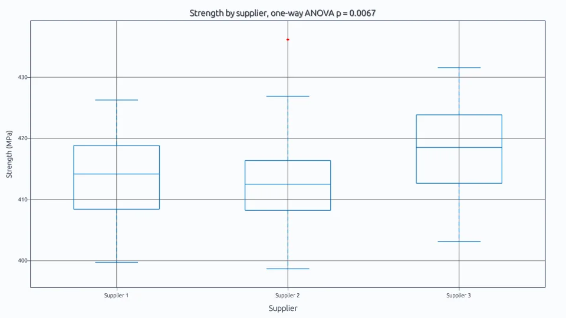

# One-way ANOVA: do three suppliers' strengths differ?

[](https://runmat.com/sandbox?example=statistics-three-batches-anova)

This example compares the tensile strength of 30 samples from each of three suppliers with a
one-way analysis of variance. The group means are 413.1, 412.9 and 418.5 MPa. The F test gives
F(2, 87) = 5.30 and p = 0.0067, so at the 5 % level at least one supplier differs from the others.

<picture>
  <source media="(prefers-color-scheme: dark)" srcset=".artifacts/thumbnail.webp">
  
</picture>

## The problem

Qualifying suppliers, comparing heat-treatment lots or checking machines on a line all ask whether
several groups share one mean. Running a t-test on every pair inflates the false-alarm rate: three
pairs at 5 % each give about a 14 % chance of at least one false difference. One-way ANOVA tests
all groups at once.

It compares two estimates of variance. The between-group mean square measures how far the group
means sit from the overall mean; the within-group mean square measures the scatter inside each
group. Their ratio is

$$F = \frac{MS_{between}}{MS_{within}}$$

with k − 1 and N − k degrees of freedom for k groups and N observations. If all means are equal, F
is near 1. A large F, with a small p-value, says the means differ more than the scatter explains.

## How the example works

1. **Generate the samples**: 30 per supplier with means of 410, 414 and 419 MPa and a common
   8 MPa standard deviation, with a fixed seed:

   ```matlab
   strength = [410 + 8*randn(30, 1), 414 + 8*randn(30, 1), 419 + 8*randn(30, 1)];
   ```

2. **Run the ANOVA** with the display turned off, and read F and its degrees of freedom from the
   table:

   ```matlab
   [p, tbl] = anova1(strength, {'Supplier 1', 'Supplier 2', 'Supplier 3'}, 'off');
   ```

3. **Draw box plots** of the three groups with the p-value in the title:

   ```matlab
   boxplot(strength, 'Labels', {'Supplier 1', 'Supplier 2', 'Supplier 3'});
   ```

## Results

```
F(2, 87) = 5.30, p = 0.0067
Group means: 413.1, 412.9, 418.5 MPa
```

With 3 groups and 90 samples, F has 2 and 87 degrees of freedom. An F of 5.30 has a p-value of
0.0067, well below 0.05. The ANOVA says only that the means are not all equal. The box plots show
where the difference lies: suppliers 1 and 2 overlap almost entirely, and supplier 3 sits about
5.5 MPa higher. Supplier 2 has one sample flagged as an outlier above its upper whisker.

## What to try

1. Set all three means to 414 MPa and see how F and p change.
2. Cut each group to 10 samples with `randn(10, 1)` and check whether the difference still reaches
   p < 0.05.
3. Compare suppliers 1 and 3 directly with `ttest2(strength(:, 3), strength(:, 1))`.

## Files

- `three-batches-anova.m`: the script: samples, one-way ANOVA and the box plots.
- `runmat.toml`: the project file.

## Related

- [Statistics in RunMat](https://runmat.com/math/statistics)
- [Comparing two batches with a t-test](../two-batches) and [kernel density estimate](../kernel-density)
- Function reference: [`anova1`](https://runmat.com/docs/reference/builtins/anova1), [`boxplot`](https://runmat.com/docs/reference/builtins/boxplot), [`ttest2`](https://runmat.com/docs/reference/builtins/ttest2)
- [Download RunMat](https://runmat.com/download)
