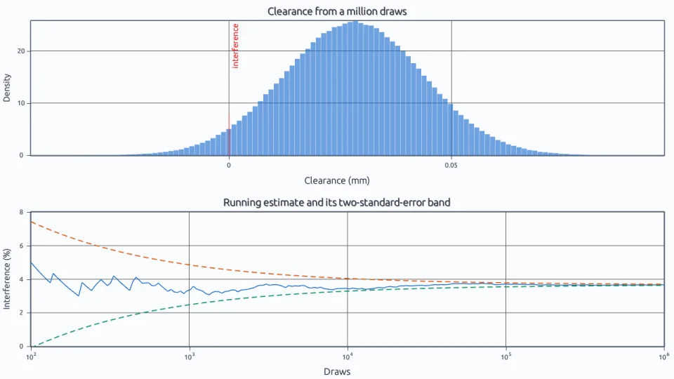

# Statistical tolerance stack-up: clearance distribution and when to stop sampling

[](https://runmat.com/sandbox?example=statistics-tolerance-stack-up)

This example stacks the tolerances of a shaft, its bore and the shaft's thermal growth over one
million random assemblies. The mean clearance is 0.0280 mm, one assembly in a thousand has less than
−0.0204 mm, and 3.669 % of assemblies interfere. The estimate's standard error is 0.019 percentage
points.

<picture>
  <source media="(prefers-color-scheme: dark)" srcset=".artifacts/thumbnail.webp">
  
</picture>

## The problem

A tolerance stack-up predicts the spread of an assembly dimension from the spreads of its parts.
Here the dimension is the diametral clearance of a 25 mm shaft in its bore:

$$c = d_{bore} - d_{shaft} - \delta_{thermal}$$

The shaft is 25.000 mm with a 0.010 mm standard deviation, the bore 25.030 mm with 0.012 mm, and
the thermal growth 0.002 mm with 0.0006 mm. Any assembly with c < 0 interferes.

A Monte Carlo stack-up samples each input, computes c for every draw, and reads probabilities and
percentiles directly from the results. Two outputs matter: the failure probability, and its
standard error √(p(1 − p)/n), which says whether enough draws were taken. A rule of thumb is to keep
drawing until the standard error is a small fraction of p itself.

## How the example works

1. **Draw one million assemblies** with a fixed seed:

   ```matlab
   shaft = 25.000 + 0.010*randn(N, 1);
   bore = 25.030 + 0.012*randn(N, 1);
   growth = 0.002 + 0.0006*randn(N, 1);
   clearance = bore - shaft - growth;
   ```

2. **Estimate the probability and its standard error**:

   ```matlab
   p = mean(clearance < 0);
   se = sqrt(p*(1 - p)/N);
   ```

3. **Read the tail** with `prctile(clearance, 0.1)`.

4. **Track convergence**: the running estimate at 200 log-spaced draw counts, inside a ±2
   standard-error band.

5. **Plot** the clearance histogram with an `xline` at zero, and the running estimate below it.

## Results

```
Interference probability 3.669%, standard error 0.019%
Mean clearance 0.0280 mm; 0.1st percentile -0.0204 mm
```

The standard error is about 0.5 % of p, so the third digit of 3.669 % is still uncertain but the
first two are settled. A relative standard error of 10 % would need about 2,600 draws at this p,
and 1 % about 263,000. In the figure the clearance histogram is a bell centered at 0.028 mm, with
the small slice left of the zero line making up the 3.669 %. Below it, the running estimate swings
between 3 % and 5 % in the first few hundred draws and settles inside the band after about 10⁴.

All three inputs are normal, so the result can be checked by hand: the clearance standard deviation
is √(0.010² + 0.012² + 0.0006²) = 0.01563 mm, which puts interference at 1.79 standard deviations
below the mean, a probability of 3.66 %.

## What to try

1. Change the bore tolerance to `0.008*randn(N, 1)`. The hand calculation gives 1.45 %.
2. Replace the shaft's normal distribution with a uniform one across ±0.017 mm,
   `25.000 + 0.034*(rand(N, 1) - 0.5)`, and compare the tail of the histogram.
3. Cut `N` to `1e4` and compare the reported standard error with the 0.019 % at a million draws.

## Files

- `tolerance-stack-up.m`: the script: random assemblies, probability, standard error, percentile and the two plots.
- `runmat.toml`: the project file.

## Related

- [Statistics in RunMat](https://runmat.com/math/statistics)
- [Monte Carlo interference probability](../monte-carlo) and [estimating pi by Monte Carlo](../estimate-pi)
- Function reference: [`randn`](https://runmat.com/docs/reference/builtins/randn), [`prctile`](https://runmat.com/docs/reference/builtins/prctile), [`xline`](https://runmat.com/docs/reference/builtins/xline)
- [Download RunMat](https://runmat.com/download)
