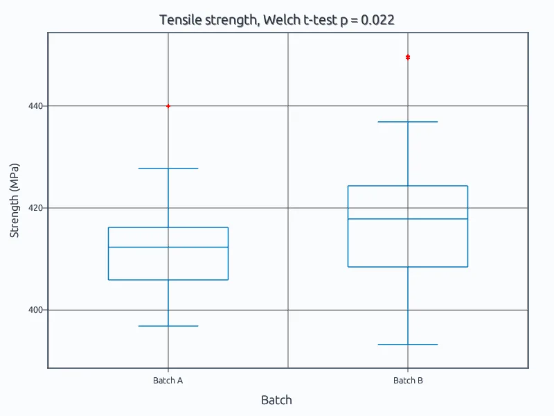

# Welch's t-test: do two batches of tensile results differ?

[](https://runmat.com/sandbox?example=statistics-two-batches)

This example compares 40 tensile results from each of two batches with box plots and Welch's
t-test. Batch A averages 413.5 MPa and batch B 415.8 MPa. The 95 % confidence interval on the
difference, −2.3 to 6.9 MPa, includes zero, and p = 0.319, so the data show no significant
difference between the batches.

<picture>
  <source media="(prefers-color-scheme: dark)" srcset=".artifacts/thumbnail.webp">
  
</picture>

## The problem

Material lots, process changes and supplier switches raise the same question: did the mean shift,
or is the difference within normal scatter? The two-sample t-test answers it by comparing the
difference in means with its standard error.

Welch's version does not assume the two batches have the same variance. It uses

$$t = \frac{\bar x_B - \bar x_A}{\sqrt{s_A^2/n_A + s_B^2/n_B}}$$

with degrees of freedom from the Welch–Satterthwaite formula. The confidence interval on the
difference is the more useful output for engineering: it states how large a shift the data allow,
in MPa, as well as whether zero is among them.

## How the example works

1. **Generate the batches**: 40 results each, batch A from a 412 MPa mean with 9 MPa spread and
   batch B from 418 MPa with 12 MPa, with a fixed seed.

2. **Summarize each batch** with its mean and standard deviation.

3. **Run Welch's t-test** on B − A:

   ```matlab
   [h, p, ci, stats] = ttest2(batchB, batchA, 'Vartype', 'unequal');
   ```

4. **Draw box plots** of both batches with the p-value in the title:

   ```matlab
   boxplot([batchA batchB], 'Labels', {'Batch A', 'Batch B'});
   ```

## Results

```
Batch A: mean 413.5 MPa, std 10.0
Batch B: mean 415.8 MPa, std 10.5
Difference B - A: 95% interval -2.3 to 6.9 MPa; t = 1.00, p = 0.319
```

The sample means differ by 2.3 MPa, about one standard error, so t = 1.00 and p = 0.319. The
batches were drawn from populations 6 MPa apart, but 40 samples per batch with this much scatter
cannot resolve that shift in this draw: the interval reaches from a 2.3 MPa drop to a 6.9 MPa gain.
The box plots overlap almost completely, and batch B has a few results flagged as outliers above
and below its whiskers.

## What to try

1. Raise each batch to 160 results. The standard error of the difference halves, so the interval
   narrows to about half its width.
2. Run the pooled-variance test by dropping `'Vartype', 'unequal'` and compare the p-values.
3. Compare three or more batches at once with [one-way ANOVA](../three-batches-anova).

## Files

- `two-batches.m`: the script: batches, summary statistics, Welch's t-test and the box plots.
- `runmat.toml`: the project file.

## Related

- [Statistics in RunMat](https://runmat.com/math/statistics)
- [Comparing three suppliers with ANOVA](../three-batches-anova) and [bootstrapping a median](../bootstrap-median)
- Function reference: [`ttest2`](https://runmat.com/docs/reference/builtins/ttest2), [`boxplot`](https://runmat.com/docs/reference/builtins/boxplot), [`std`](https://runmat.com/docs/reference/builtins/std)
- [Download RunMat](https://runmat.com/download)
